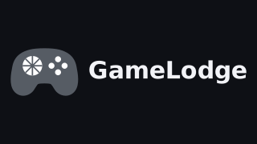
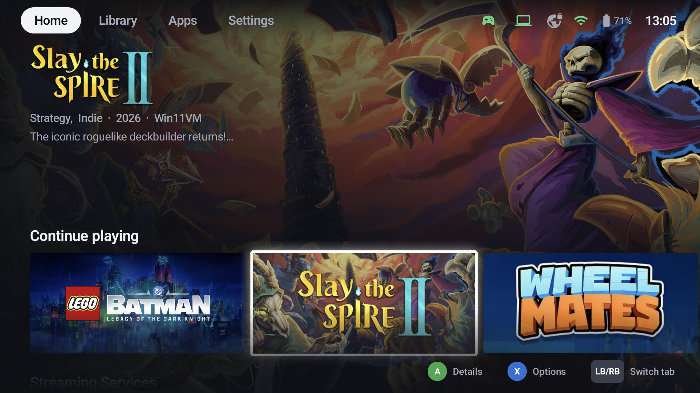
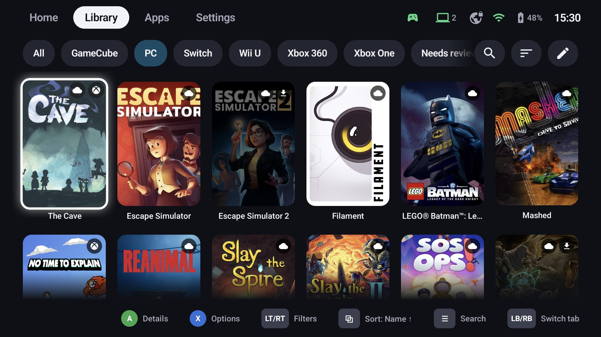
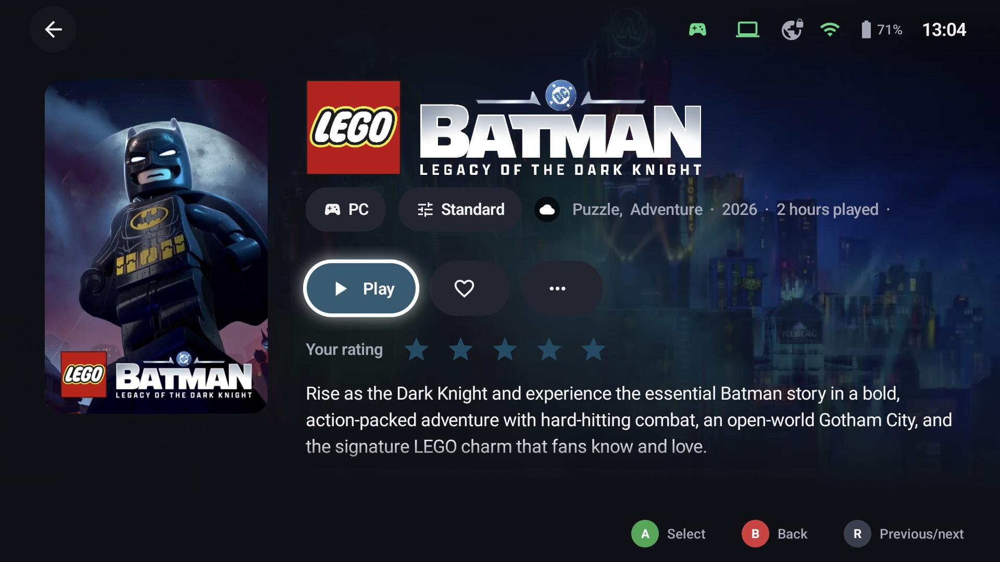
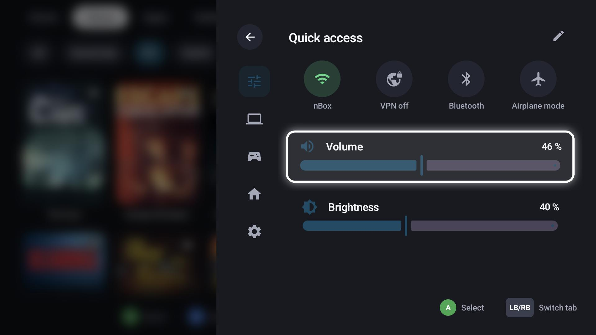
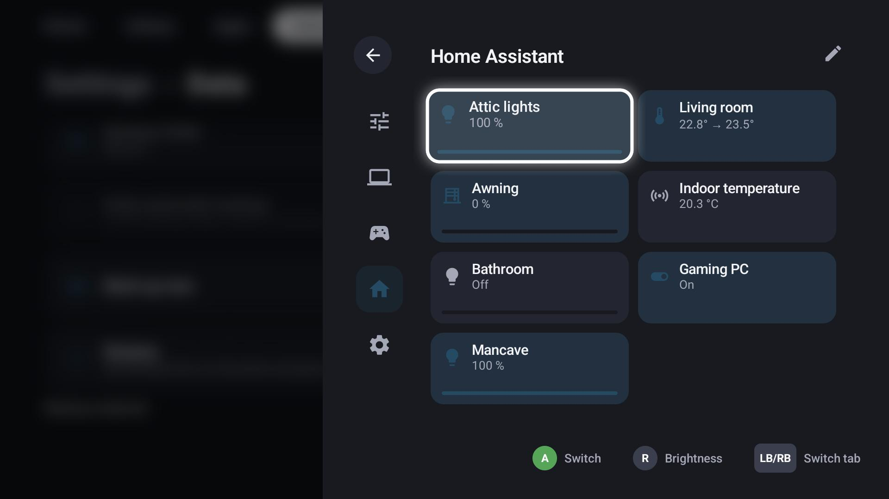
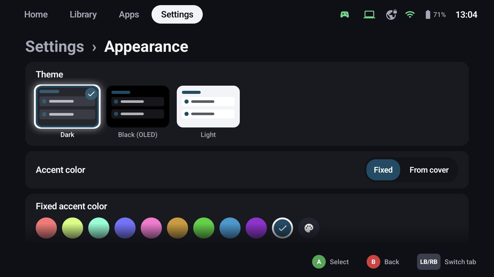

<p align="center">
  
</p>

<p align="center">
  <b>All your games in one controller-first launcher – local, streamed and emulated.</b>
</p>

<p align="center">
  <a href="https://github.com/thecodingdad/gamelodge/releases/latest"></a>
  <a href="https://github.com/thecodingdad/gamelodge/releases"></a>
  <a href="https://github.com/thecodingdad/gamelodge/actions/workflows/build.yml"></a>
  <a href="LICENSE"></a>
  <br>
  
  
  
  <a href="https://thecodingdad.github.io/gamelodge/"></a>
</p>

GameLodge is a game launcher for Android handhelds, tablets, TVs and Windows PCs. It brings the games
installed on the device, the games of your streaming PCs (Sunshine, Apollo, Vibepollo) and your
emulated games together in one library with artwork and metadata, and starts each one the right way.
It is built for the controller first – every screen works with a gamepad alone – while touch, mouse and
keyboard work everywhere too. Streaming is built in, based on
[Artemis](https://github.com/ClassicOldSong/moonlight-android) on Android and
[Moonlight](https://github.com/moonlight-stream/moonlight-qt) on Windows.

<p align="center">
  
  
  
  
  
  
</p>

## Features

**One library**
- Android apps and games, the games of your streaming hosts, PC store games (Steam, Epic, GOG, Xbox, EA, Ubisoft, Battle.net, Amazon, Playnite) and emulated ROMs side by side
- Covers, backgrounds, logos and animated artwork from SteamGridDB and IGDB, a metadata editor for corrections
- Smart filters, groups and collections, favourites, ratings, play time and statistics – synced between your devices through the host

**Streaming**
- Pairing, wake-up (Wake-on-LAN or Home Assistant) and auto sleep for your hosts, stream profiles for resolution, frame rate, bitrate and HDR
- Every controller passed through as its own gamepad, with per-controller vibration, motion and battery settings
- Built-in WireGuard VPN that connects only when a host isn't reachable at home (Android)

**Made for controllers**
- Gamepad navigation everywhere, button hints for the connected controller (Xbox, PlayStation, Nintendo layouts)
- Configurable button shortcuts: back to GameLodge, quick menu, mouse emulation, performance overlay, on-screen keyboard
- A quick menu over every game and stream: quick access toggles, volume and brightness, hosts, controllers, Home Assistant

**Home Assistant**
- Your entities as tiles on the Home tab and in the quick menu, with your own names
- Actions before or after a game starts, host power control, launcher status via MQTT

**Make it yours**
- Home tab with rows of your choice, tile formats and sizes per tab, dark, black (OLED) and light themes with accent colours
- TV mode for external displays, screensaver with your artwork, six languages (English, German, French, Spanish, Italian, Portuguese)
- Setup wizard, backups with artwork and optionally encrypted credentials

**Android**
- Works as the home screen, button shortcuts in every app (accessibility service), emulator presets for ROM folders

**Windows**
- Full-screen launcher with tray and autostart, PC store games scanned automatically
- Host role: shares the PC's games, artwork and play data with your other GameLodge devices (paired, with web admin)

See the [documentation](https://thecodingdad.github.io/gamelodge/) for every feature in detail.

## Download

Get the latest version from the [releases](https://github.com/thecodingdad/gamelodge/releases/latest):

- **Android**: `GameLodge-<version>.apk` – Android 10 or newer (built for the AYN Odin 2 Portal, runs on other handhelds, tablets and TVs)
- **Windows**: `GameLodge-Setup-<version>.exe` – Windows 10 or 11 (x64)

The setup wizard on first start walks you through controllers, hosts, metadata keys and the rest.

## Building

Requirements: JDK 21, Android SDK 36, NDK 27.0.12077973.

```bash
git clone --recurse-submodules https://github.com/thecodingdad/gamelodge.git
cd gamelodge
./gradlew :app:assembleRelease          # Android APK
./gradlew :desktop:windowsZip           # Windows build (jars + runtime)
```

The Windows installer is built with Inno Setup (`desktop/windows/`), the bundled Moonlight comes from
the [moonlight-qt fork](https://github.com/thecodingdad/moonlight-qt).

| Path | Content |
|---|---|
| `shared/` | Kotlin Multiplatform module: UI (Compose) and logic for Android and Windows |
| `app/` | Android app |
| `desktop/` | Windows app |
| `host/`, `protocol/` | Host role: pairing, client API, web admin |
| `server/` | Standalone metadata server (Docker) |
| `artemis/` | [Artemis fork](https://github.com/thecodingdad/moonlight-android) with the changes for GameLodge (submodule) |
| `moonlight-qt/` | [Moonlight PC fork](https://github.com/thecodingdad/moonlight-qt) with the changes for GameLodge (submodule) |

## Credits

GameLodge stands on the work of [Moonlight](https://moonlight-stream.org),
[Artemis](https://github.com/ClassicOldSong/moonlight-android),
[Nonary's Moonlight PC](https://github.com/Nonary/moonlight-qt),
[Sunshine](https://github.com/LizardByte/Sunshine), [Apollo](https://github.com/ClassicOldSong/Apollo)
and [Vibepollo](https://github.com/Nonary/Vibepollo). Artwork and metadata come from [SteamGridDB](https://www.steamgriddb.com) and
[IGDB](https://www.igdb.com).

## License

GPL-3.0, see [LICENSE](LICENSE). Game titles, artwork, platform and store names shown in the app and
in the screenshots belong to their respective owners; GameLodge isn't affiliated with or endorsed by any
of them.
