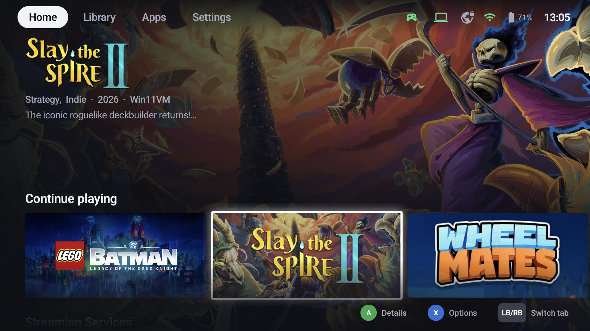
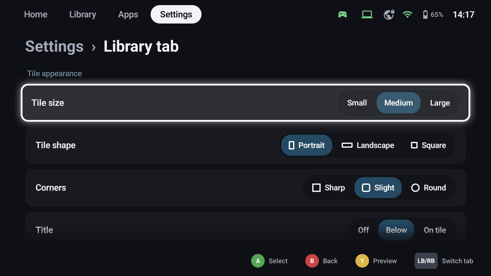
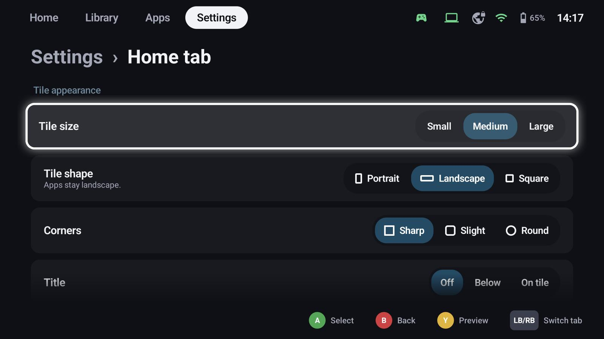
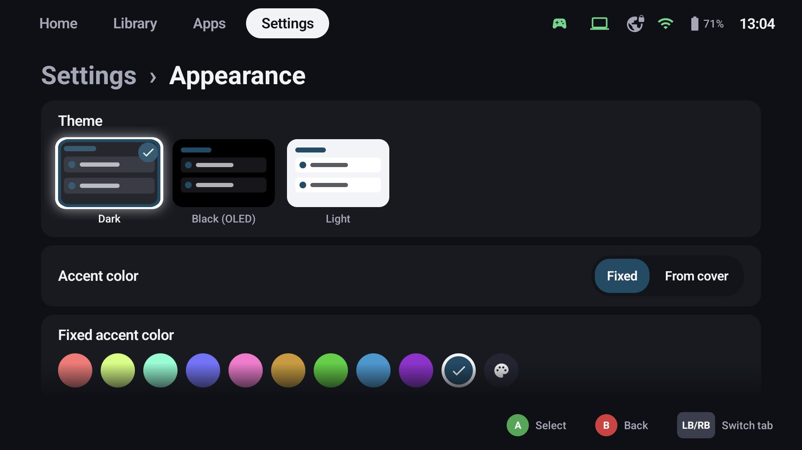

# Home tab & tiles

## The tabs

GameLodge has three tabs: **Home**, **Library** and **Apps** (plus Settings). **Default tab** chooses which
one opens after starting and when Home is pressed.

The Home tab shows the focused game big – its background, logo, genres, play time and description – above
rows of your choice: *Continue playing*, favourites, recently added, any [filter or group](filters.md) and
your [Home Assistant](home-assistant.md) tiles. Turn rows on with **Show as row on the Home tab** in a
filter's settings.

## Tiles per tab

**Settings → Home tab / Library tab / Apps tab** set the tiles of each tab separately:

| Setting | Options |
|---|---|
| Tile size | Small, medium, large |
| Tile shape | Portrait cover, landscape (16:9), square – apps stay landscape on the Home tab |
| Corners | Sharp, slight, round |
| Title | Off, below the tile, on the tile |
| Extra info | None, play time, last played, progress (play time against the time to beat) |
| Badges | Where an entry comes from (Android, PC, ROM, host), installed state |
| Apps tab | Icons or banners |

**Y** shows a **live preview** of a tile with your settings.

When a game has no artwork in the chosen shape, GameLodge builds one: background plus logo, or the cover on
its own blurred background.

## Appearance

- Themes **Dark**, **Black (OLED)** and **Light**
- **Accent colour**: fixed (presets or your own colour) or *From cover* – taken from the focused game
- Focus zoom and glow, dimming of games that aren't installed, animations, UI size

## Sounds & vibration

UI sounds with volume and style, which events play a sound, and the vibration strength of the interface.

## Language

English, German, French, Spanish, Italian and Portuguese (Brazil), or the device's language
(**Settings → Language**).

## See also

- [Filters, groups & collections](filters.md) – Home rows
- [TV mode & screensaver](tv.md)
- [Library](library.md)
