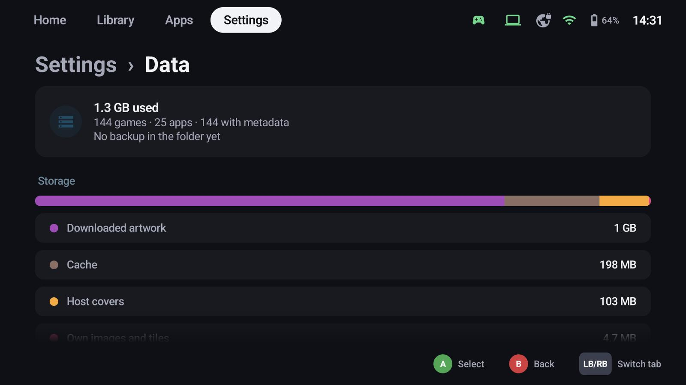
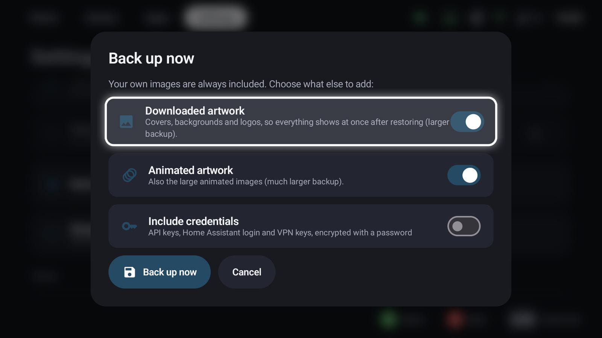
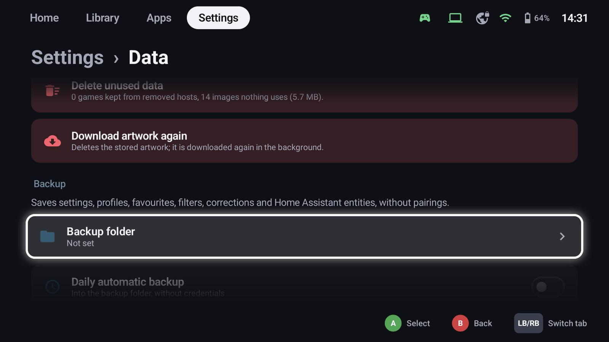
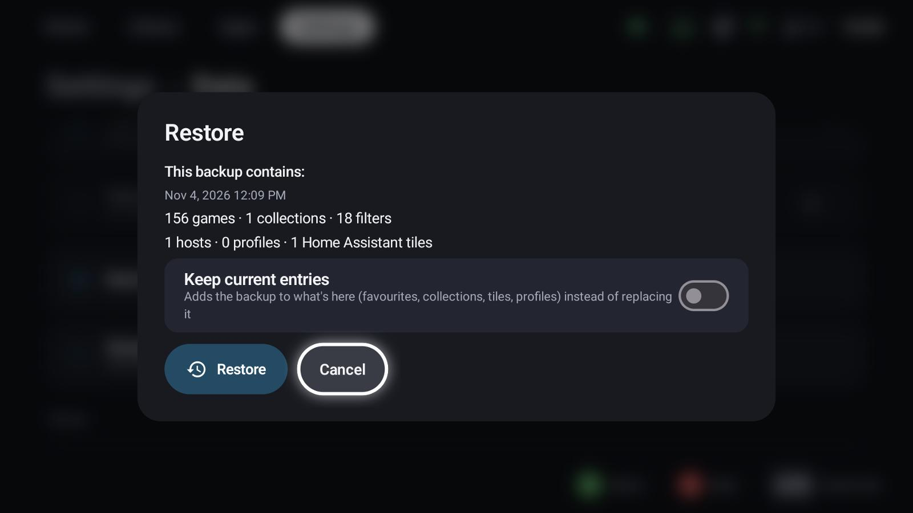

# Backup & restore

**Settings → Data** shows the storage GameLodge uses, cleans up, and saves and restores your setup.

## Storage and clean-up

The bar shows downloaded artwork, cache, host covers, your own images, the library database and settings.

- **Clear cache** – images and server answers, filled again when needed
- **Delete unused data** – games kept from removed hosts and images nothing uses (hold)
- **Download artwork again** – deletes the stored artwork; it downloads again in the background (hold)

## What a backup contains

Settings, stream profiles, favourites, ratings, play time, filters and groups, metadata corrections, Home
Assistant tiles and host settings. Your own images are always included.

{ width="600" }

- **Downloaded artwork** – everything shows at once after restoring (larger backup)
- **Animated artwork** – also the large animated images (much larger)
- **Include credentials** – API keys, the Home Assistant login and VPN keys, encrypted with a password you
  enter twice

!!! info "Pairings are never part of a backup"
    The keys that pair a device with your hosts live in the device's secure storage and can't be exported:
    a file with them would let anyone act as your device. Pair the new device instead – the setup wizard
    does that before it restores.

## Backing up

- **Backup folder** – where backups go; without one, **Back up now** asks where to save.
- **Daily automatic backup** – into the backup folder (without credentials), keeping the newest 3, 7, 14
  or 30.
- **Back up now** – with the choices above.

Backups run in the background with their progress (in percent) on the Data page and in the task list, and
can be cancelled there. Only one backup or restore runs at a time; a cancelled backup leaves no file behind.

## Restoring

Pair your hosts first, so favourites and play time find their games. Then **Restore** and pick the backup:

{ width="600" }

The dialog shows what the backup contains and asks for the password if it has credentials.

- By default the backup **replaces** the current state: tiles, groups, profiles and host settings that
  aren't in the backup are removed, favourites and ratings of other games reset.
- **Keep current entries** adds the backup to what's there instead.

Either way, play time keeps the higher value (it's measured, the host has it too), and credentials that
aren't in the backup stay. The restore can be cancelled while it still unpacks images; once it writes the
library it finishes.

## Moving to a new device

Back up on the old device, then choose **Restore a backup** on the first page of the [setup wizard](wizard.md)
on the new one: it pairs your hosts first and then restores.
