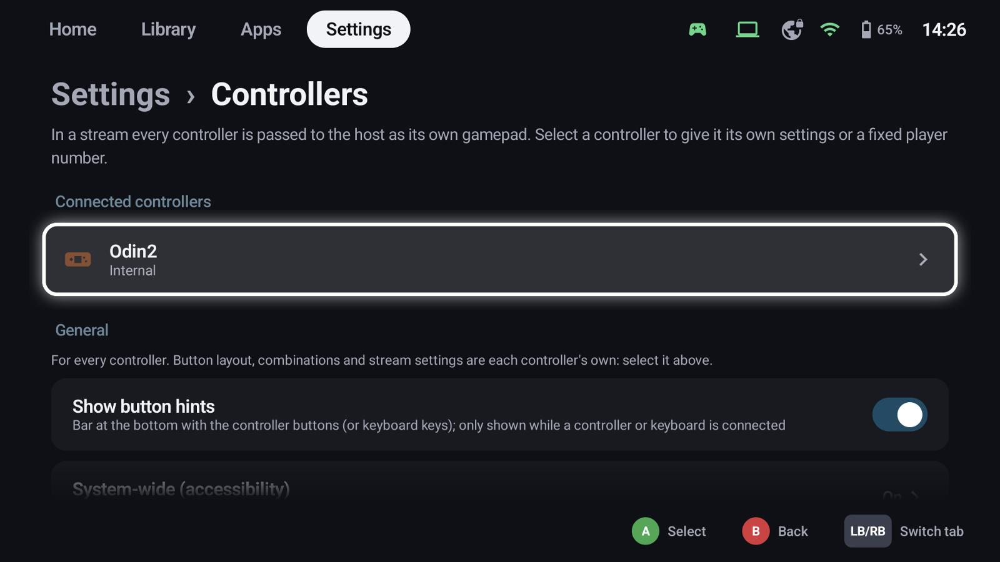
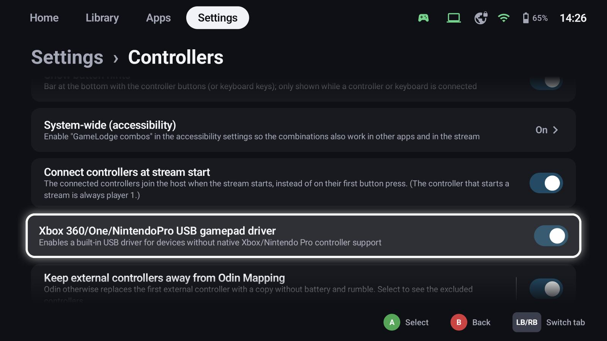
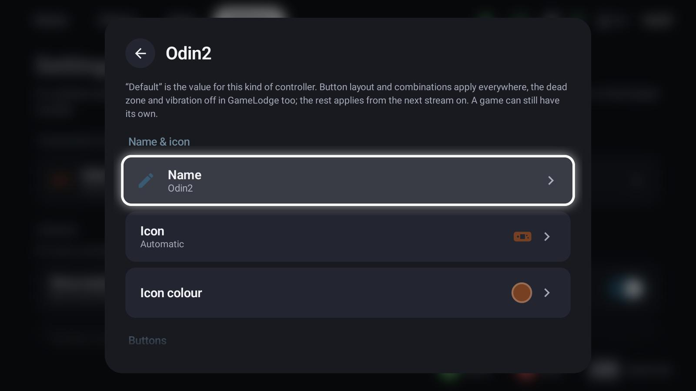
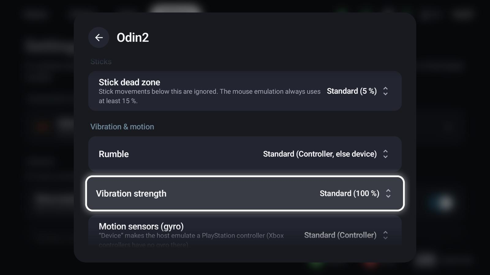
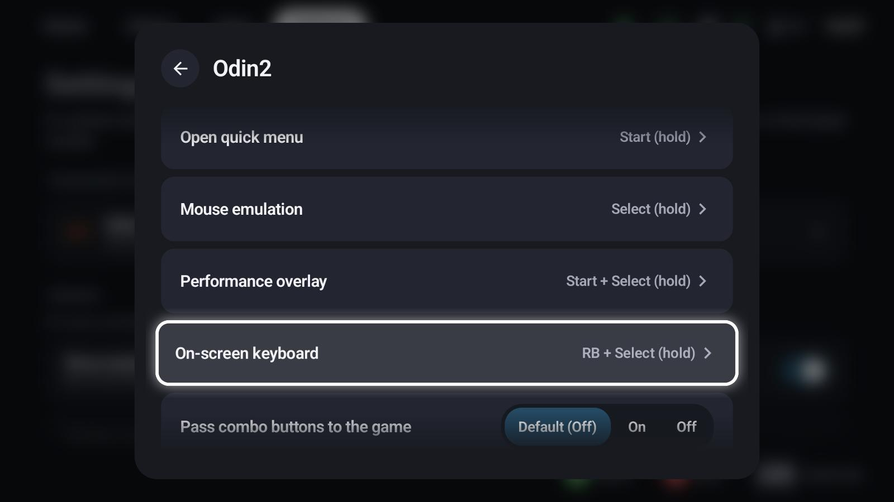
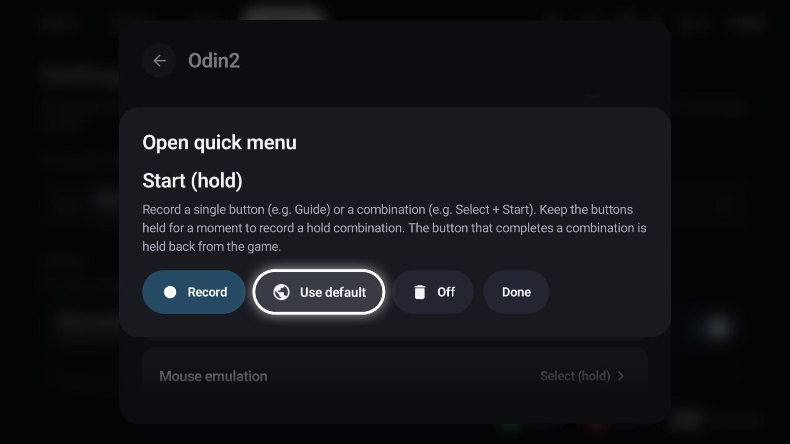
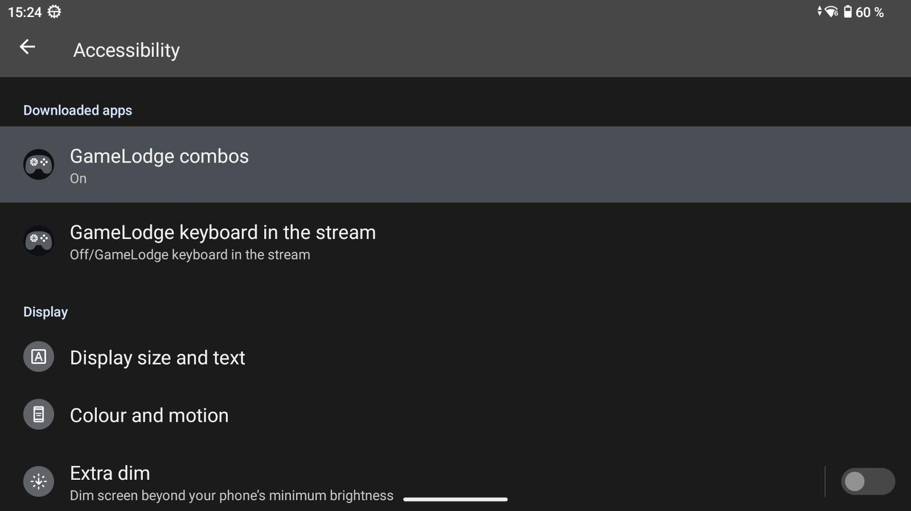

# Controllers & shortcuts

GameLodge is made to be used with a controller. Every controller – the built-in controls of a handheld, an
Xbox, PlayStation, Nintendo or other pad – keeps its own settings, starting from defaults for its model.

## The controllers page

**Settings → Controllers** lists the connected controllers. In a stream every controller is passed to the
host as its own gamepad.

General settings for all controllers:

- **Show button hints** – the bar at the bottom, only while a controller (or keyboard) is connected
- **System-wide (accessibility)** – shortcuts in other apps too (Android, see [below](#shortcuts-in-other-apps-android))
- **Connect controllers at stream start** – all controllers join the host when the stream starts, not on
  their first button press; the controller that starts the stream is always player 1
- **USB gamepad driver** for Xbox 360 / One / Nintendo Pro pads without native support (Android)
- **Mouse emulation** – pointer speed and acceleration, see [Mouse emulation](mouse.md)

## A controller's own settings

Select a controller:

{ width="600" }

- **Name**, **icon** and **icon colour** – how it appears in GameLodge
- **Button layout** – Xbox (A below) or Nintendo (A right)
- **Button shortcuts** (below)
- **Stick dead zone**, **rumble** (the controller's motors, or the device's when the controller has none),
  **vibration strength** and **motion sensors** (the controller's gyro or the device's)
- **Player number** in streams

{ width="600" }

"Default" is the value for this kind of controller. Layout and shortcuts apply everywhere; the dead zone and
vibration also in GameLodge; the rest applies from the next stream on.

## Button shortcuts

{ width="600" }

| Action | Default | Does |
|---|---|---|
| Back to GameLodge | Guide | Brings GameLodge to the front from a game or stream; in GameLodge it goes to the Home tab |
| Open quick menu | Start (hold) | Opens the [quick menu](quick-menu.md) |
| Mouse emulation | Select (hold) | Switches the [mouse pointer](mouse.md) on or off |
| Performance overlay | Start + Select (hold) | Shows the stream's performance figures |
| On-screen keyboard | LB + Select (hold) | Shows the keyboard in the stream |

Select an action to record your own: press a single button or a combination; keep it held for a moment
to record a **hold** combination. **Use default** goes back to the controller's default, **Off** removes the
shortcut.

{ width="600" }

The same shortcuts work in GameLodge, in streams and – on Windows – system-wide while GameLodge runs. A, B and the D-pad alone stay reserved for navigation, and a combination
can only be used once.

**Pass combo buttons to the game**: off (default), the shortcut's buttons only run the action; on, they
also reach the game.

!!! info "Short presses of hold buttons"
    In GameLodge and in the stream a short press of a button with a hold shortcut still reaches the game.
    In other Android apps it is passed on at once and the shortcut runs in addition when held – Android
    doesn't let an app hand on a press later.

## Shortcuts in other apps (Android)

In GameLodge and in the stream the shortcuts work right away. For other apps – Android games, a browser, an
emulator – switch on **System-wide (accessibility)** under **Settings → Controllers** (systemwide edition only,
see [Install](getting-started.md#install)). It opens Android's
accessibility settings:

- **GameLodge combos** – the button shortcuts in every app. In the stream it also passes keys of a hardware
  keyboard that Android would otherwise use itself (e.g. Alt+Tab, the Windows key) to the streamed PC. The service
  only reads controller and keyboard keys, nothing on the screen.

!!! note "Installed outside an app store"
    Android greys the service out until restricted settings are allowed: open GameLodge's app info,
    menu (⋮) → **Allow restricted settings**, then enable the service.

## Touch, mouse & keyboard

**Settings → Touch, mouse & keyboard**: everything also works with touch, a mouse (side buttons can switch
tabs) and a keyboard – keys for confirm, back, quick menu and home, and a quick menu shortcut. On Windows
the shortcut (always with Ctrl, Alt or Shift) works system-wide, also with a game or stream in front.

## See also

- [Quick menu](quick-menu.md)
- [Mouse emulation](mouse.md)
- [Stream profiles](profiles.md) – controllers in the stream
- [Getting started](getting-started.md) – permissions on Android
