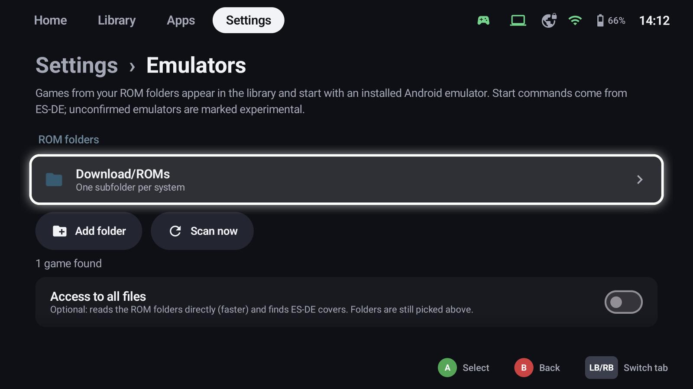
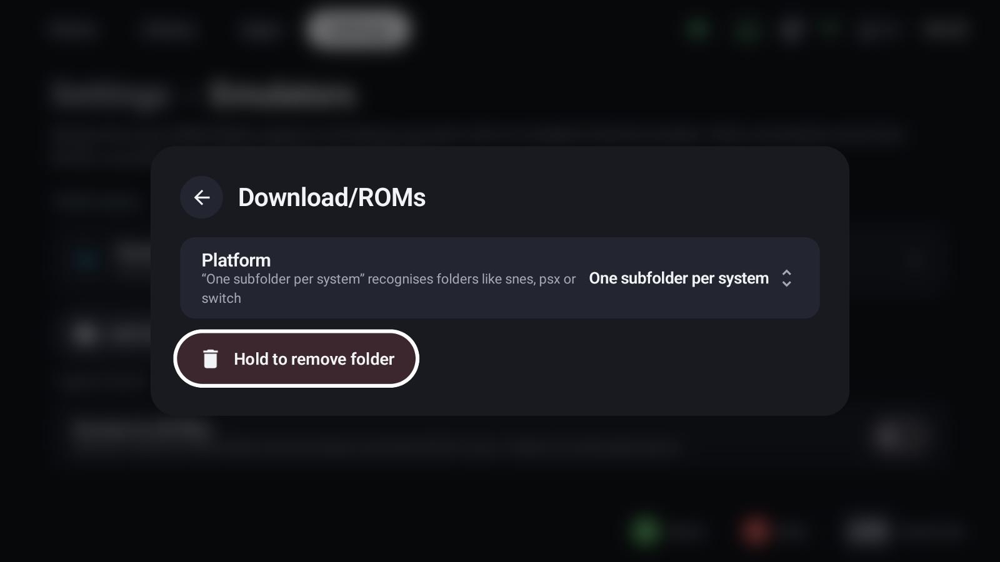
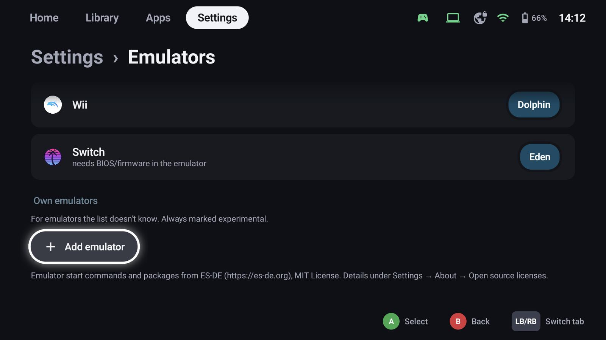
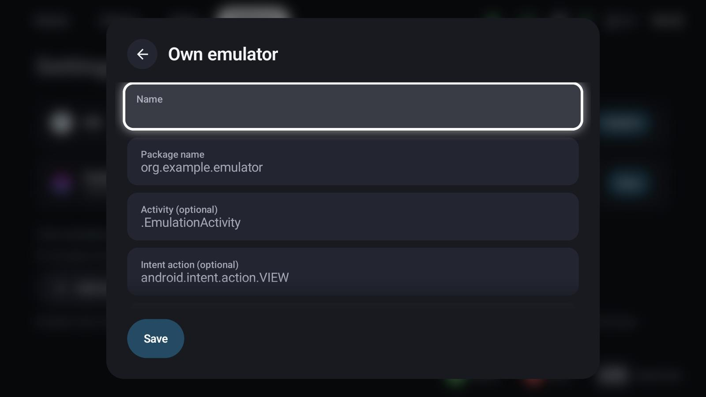

# Emulators & ROMs

On Android, GameLodge turns your ROM folders into library entries that start with an installed emulator –
with the same artwork, metadata, play time and controller handling as every other game.



## How it works

1. You pick one or more **ROM folders**.
2. GameLodge scans them and recognises each game's **platform** – from the subfolder name (`snes`, `psx`,
   `switch` …) or from the platform you assign to the folder.
3. Each platform starts with an **emulator** installed on the device. GameLodge knows the start command of
   each supported emulator (taken from [ES-DE](https://es-de.org)) and hands it the ROM file.
4. The games appear in the library with a **ROM** badge, get metadata and artwork like every other game,
   and play time is measured by GameLodge itself.

If one of your streaming hosts has the same game on the same platform (for example from a Playnite
library), both are merged into one entry; you choose where to start it.

## Set up

Open **Settings → Emulators** (or the *Emulators & ROMs* step of the [setup wizard](wizard.md)).

### ROM folders

**Add folder** opens Android's folder picker. Select a folder that contains your games and allow access.

{ width="600" }

Selecting a folder opens its settings:

- **Platform**: *One subfolder per system* (recommended) recognises subfolders like `snes`, `psx` or `switch`;
  or assign one platform to the whole folder.
- **Hold to remove folder** removes it from GameLodge (the files stay).

A typical layout:

```text
ROMs/
├── gba/        Advance Wars.gba
├── n64/        …
├── ps2/        Okami.chd
├── psp/        …
└── snes/       Super Metroid.sfc
```

**Scan now** reads the folders again, e.g. after you added games.

!!! tip "Access to all files"
    Optional: with **Access to all files** GameLodge reads the ROM folders directly. Scanning is faster and
    ES-DE covers next to your ROMs are found. Folders are still picked as above.

### Emulator per platform

Every platform with games or an installed emulator is listed with the emulator it uses. Select a platform
to choose another installed emulator. A note shows when an emulator needs **BIOS / firmware** files – add
them in the emulator itself.



A single game can use another emulator than its platform: pick it when you start the game ("Platform
default" keeps the platform's choice).

## Supported platforms

| Platform | Folder names | Emulators |
|---|---|---|
| Arcade | `arcade`, `mame`, `fbneo`, `neogeo` | FinalBurn Neo, MAME (RetroArch), MAME4droid, Flycast |
| Dreamcast | `dreamcast`, `dc` | Flycast, Redream, Flycast (RetroArch) |
| Game Boy / Color / Advance | `gb`, `gbc`, `gba` | GBC.emu, GBA.emu, My Boy!, Pizza Boy, SkyEmu, mGBA, Gambatte, SameBoy (RetroArch) |
| GameCube / Wii | `gc`, `gamecube`, `ngc` / `wii` | Dolphin, Dolphin MMJR, Dolphin (RetroArch) |
| Wii U | `wiiu` | Cemu |
| Nintendo Switch | `switch`, `ns` | Eden, Kenji-NX, Skyline |
| Nintendo DS / 3DS | `nds`, `ds` / `n3ds`, `3ds` | DraStic, melonDS, NooDS / Azahar, Citra, Lime3DS, Panda3DS |
| NES / SNES / N64 | `nes`, `snes`, `n64` | Nestopia UE, Mesen, Snes9x, bsnes, Mupen64Plus, M64Plus FZ (RetroArch and standalone) |
| PlayStation / PS2 / PSP | `psx`, `ps1` / `ps2` / `psp` | DuckStation, ePSXe, SwanStation / NetherSX2, AetherSX2, Play! / PPSSPP |
| PlayStation 3 | `ps3` | aPS3e, ARMSX3 (experimental) |
| Sega Master System / Mega Drive | `mastersystem`, `sms` / `megadrive`, `genesis`, `md` | Genesis Plus GX, PicoDrive, BlastEm, MD.emu |
| Xbox / Xbox 360 | `xbox` / `xbox360`, `x360` | X1 BOX, Xenra, aX360e (experimental) |

Emulators not confirmed with GameLodge yet are marked **experimental**.

## Own emulators

For an emulator the list doesn't know, **Add emulator** under *Own emulators* defines its start command:

{ width="600" }

| Field | Meaning |
|---|---|
| Name | Shown in the emulator choice |
| Package name | The emulator's Android package, e.g. `org.example.emulator` |
| Activity | Optional: the activity to start (otherwise the app's main one) |
| Intent action | Optional, e.g. `android.intent.action.VIEW` |
| Data URI | Optional: the file to open, with placeholders |
| Extras | Optional: `name=value` pairs separated by `;`, typed with `bool:`, `int:` or `long:` in front |
| Platforms | The platforms it can run |

Placeholders: `%ROMSAF%` (the file as content URI), `%ROM%` (the file path), `%BASENAME%` (file name without
extension). Own emulators are always marked experimental.

## Playing

Start a ROM like any other game. GameLodge starts the emulator with the ROM, measures the play time and
brings you back with your **Back to GameLodge** shortcut. In-game controls are the emulator's own; set them
up there once.
