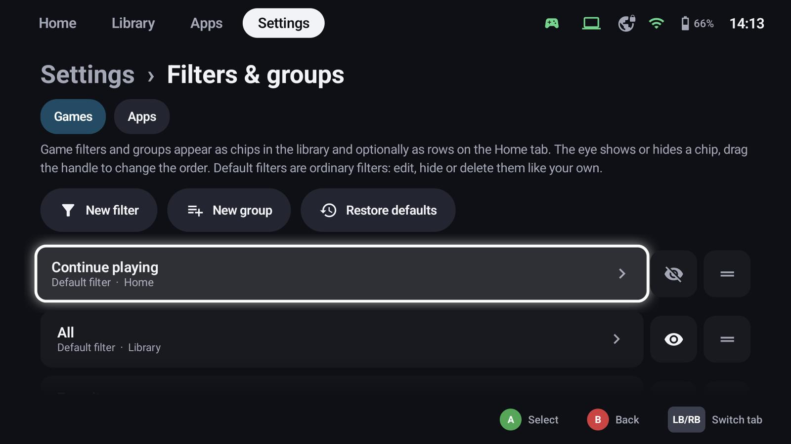
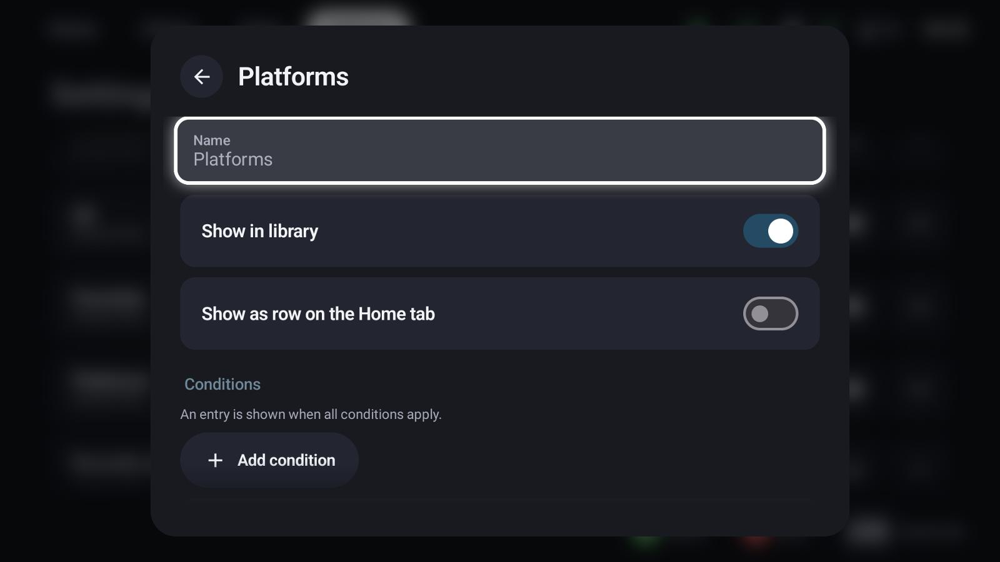
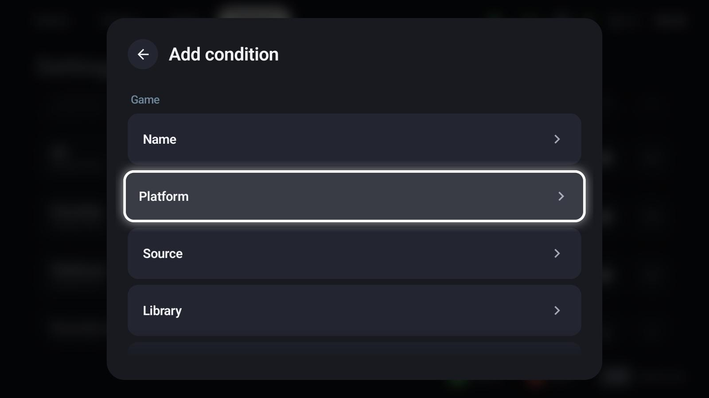
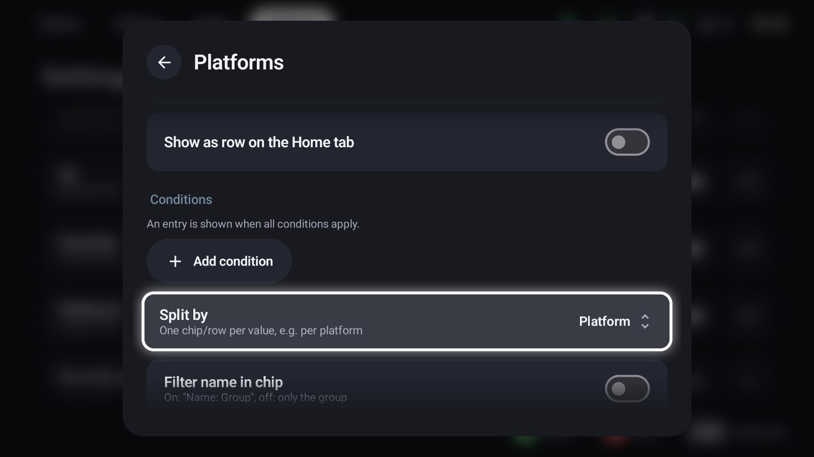
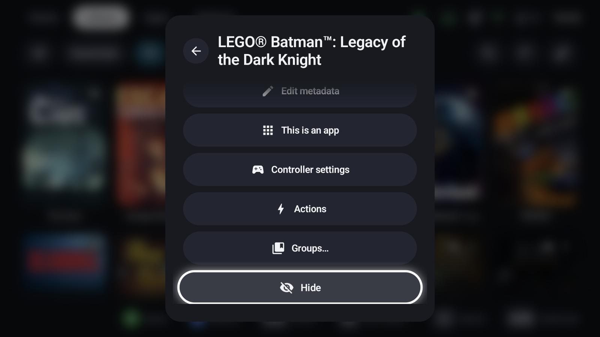

# Filters, groups & collections

The chips above the Library and Apps tabs are filters. Each one can also be a row on the Home tab.
**LT / RT** switches between them, tapping a chip selects it.

## Manage them

**Settings → Filters & groups** lists the filters of the *Games* and the *Apps* side:

- the **eye** shows or hides a chip,
- the **handle** changes the order (drag it, or A then up / down),
- **New filter**, **New group** and **Restore defaults**.

The default filters (Continue playing, All, Favorites, Platforms, Recently added, Hidden …) are ordinary
filters: edit, hide or delete them like your own.

## Smart filters

A smart filter shows everything that matches its conditions.

{ width="600" }

- **Name**, **Show in library** and **Show as row on the Home tab**
- **Conditions** – an entry is shown when *all* conditions apply. Add one with **Add condition**:

{ width="600" }

| Condition | Example |
|---|---|
| Name | Entries whose name contains a text |
| Platform | PC, GameCube, PlayStation 2 … |
| Source | Android, host, ROM, a PC store |
| Library | Installed or not |
| Genre, developer, release year, rating | From the metadata |
| Played / favourite / hidden | Your own data |
| Playnite categories | Categories of host games from Playnite |

Within a condition, choose values to **include** (entries with one of them) or **exclude** (entries without
them); **Match all** requires every chosen value.

### Split by

**Split by** turns one filter into one chip – and one Home row – per value, for example one chip per
platform. The default *Platforms* filter works like that: it creates the GameCube, PC, Switch … chips.

{ width="600" }

Further options: whether the chip and the Home row show the filter's name ("Platforms: PC") or only the
value, the **order** (name, last played, play time, rating, release year, time to beat …) and a
**maximum number** of entries – useful for Home rows like "Recently added".

## Groups (collections)

A group is a hand-picked list. Create one with **New group**, then add games with **X → Groups…** on any
tile – a game can be in several groups. Groups show as chips and Home rows like filters; with a GameLodge
host they are shared with your other devices.

{ width="600" }

## Hidden entries

**X → Hide** removes an entry from all filters; it only shows under the **Hidden** chip. For host games you
choose whether hiding applies only on this device or on all your devices.
