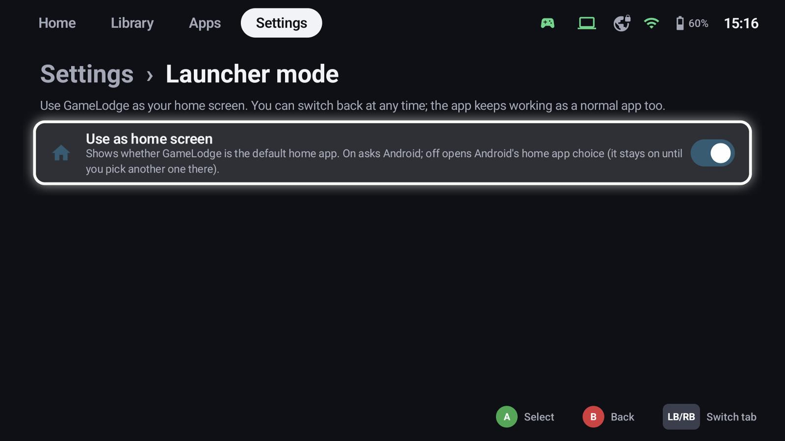
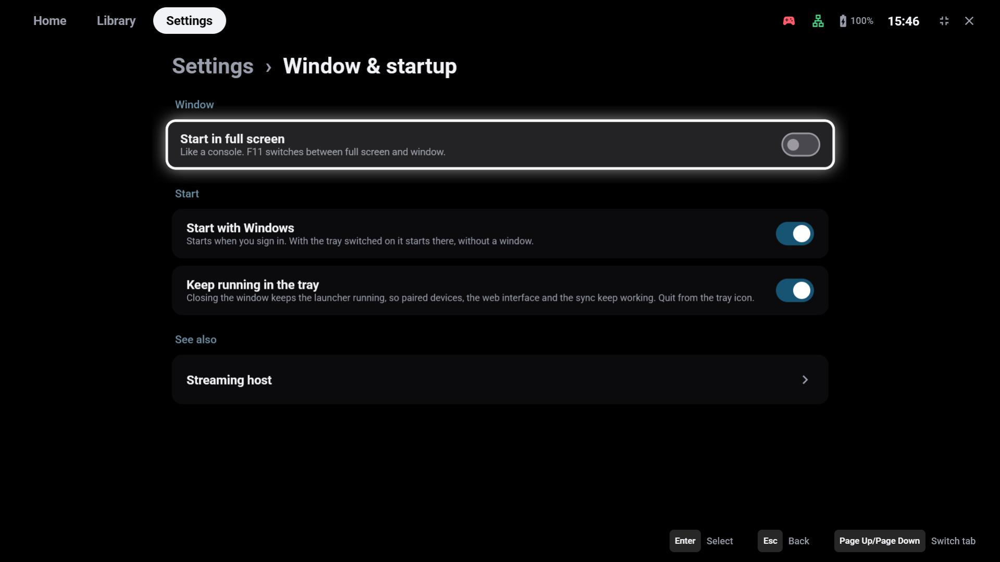

# Getting started

## Install

Download the latest version from the
[releases page](https://github.com/thecodingdad/gamelodge/releases/latest). GameLodge is free software under the
[GPL-3.0](https://github.com/thecodingdad/gamelodge/blob/main/LICENSE); what it stores and sends is described under
[Privacy](privacy.md).

=== "Android"

    1. Download the APK for your device (or copy it there):
        - `GameLodge-<version>.apk` – for most devices
        - `GameLodge-Systemwide-<version>.apk` – controller shortcuts in every app, e.g. on handhelds like the
          AYN Odin 2 Portal
    2. Open it and allow installing apps from this source when Android asks.
    3. Start GameLodge – the setup wizard opens.

    Android 10 or newer. Both are the same app with the same data; only the systemwide edition has the
    accessibility service that makes [button shortcuts work in other apps](controllers.md#shortcuts-in-other-apps-android).
    Google Play Protect blocks apps with such a service when they are installed from a file ("App blocked
    to protect your device") – `GameLodge-<version>.apk` leaves it out.

=== "Windows"

    1. Download `GameLodge-Setup-<version>.exe` and run it.
    2. Choose an installation for your user or for all users.
    3. Start GameLodge from the start menu – the setup wizard opens.

    Windows 10 or 11, 64-bit. The installer brings its own Java runtime and the streaming client.

## The setup wizard

The wizard walks you through everything once; each step can be skipped and changed later in the
settings. Language and controller layout are the only required steps.

| Step | What you set |
|---|---|
| Welcome | Language, or **restore a backup** from another device |
| Controller | Button layout of your controller (Xbox / Nintendo), with a live button test |
| Button shortcuts | Back to GameLodge, quick menu, mouse emulation, performance overlay, on-screen keyboard (see [Controllers](controllers.md)) |
| Appearance | Theme, accent colour, size and animations |
| Home app | Android: use GameLodge as the home screen |
| Permissions | Android: usage access for play time, overlays, Bluetooth and more |
| Startup | Windows: full screen, start with Windows, tray |
| Game sources | Windows: PC stores to scan |
| Emulators | Android: ROM folders and emulators |
| Streaming hosts | Find and pair your Sunshine / Apollo / Vibepollo PCs |
| Metadata | SteamGridDB and IGDB keys, with step-by-step guides and QR codes |
| Home Assistant | Sign in to show your entities as tiles |
| VPN | Android: WireGuard tunnel for streaming away from home |

!!! tip "Moving to a new device"
    Choose **Restore a backup** on the welcome page. The wizard first pairs your hosts and then restores
    favourites, play time and settings, so everything finds its games again. Pairings themselves are never
    part of a backup (see [Backup & restore](backup.md)).

## Home screen (Android)

**Settings → Launcher mode** makes GameLodge the home app: the Home button and the device start lead to
it. You can switch back at any time; GameLodge also works as a normal app.

Switching it on asks Android; switching it off opens Android's home app choice – GameLodge stays the home
app until you pick another one there.

## Permissions (Android)

Each permission is optional and only needed for one feature. The setup wizard asks for them; Android's app
info for GameLodge changes them later.

| Permission | Used for |
|---|---|
| Usage access | Play time of apps and games started outside GameLodge |
| Display over other apps | The quick menu over games and streams |
| Modify system settings | Brightness in the quick menu |
| Nearby devices / location | Bluetooth controllers and the Wi-Fi name in quick access |
| Notifications | Status notifications (e.g. while the VPN is connected) |
| Accessibility | Button shortcuts in other apps, see [Controllers](controllers.md#shortcuts-in-other-apps-android) |
| Access to all files | Optional: faster ROM scans and ES-DE covers, see [Emulators](emulators.md) |

## Window & startup (Windows)

**Settings → Window & startup**:

- **Start in full screen** – like a console; **F11** switches between full screen and window at any time
- **Start with Windows** – starts when you sign in; with the tray switched on it starts there, without a
  window
- **Keep running in the tray** – closing the window keeps GameLodge running, so paired devices, the web
  interface and the game sync keep working. The tray icon opens it again, opens the web interface or quits.

!!! info "Xbox Game Bar"
    While GameLodge runs, the Guide button belongs to it (back to GameLodge, quick menu). Windows' option
    *Open Xbox Game Bar using this button on a controller* is switched off meanwhile and restored when
    GameLodge quits.

## See also

- [Setup wizard](wizard.md) – every step in detail
- [Controllers & shortcuts](controllers.md) – shortcuts in other apps on Android
- [Backup & restore](backup.md) – moving to a new device
- [FAQ & troubleshooting](faq.md)
