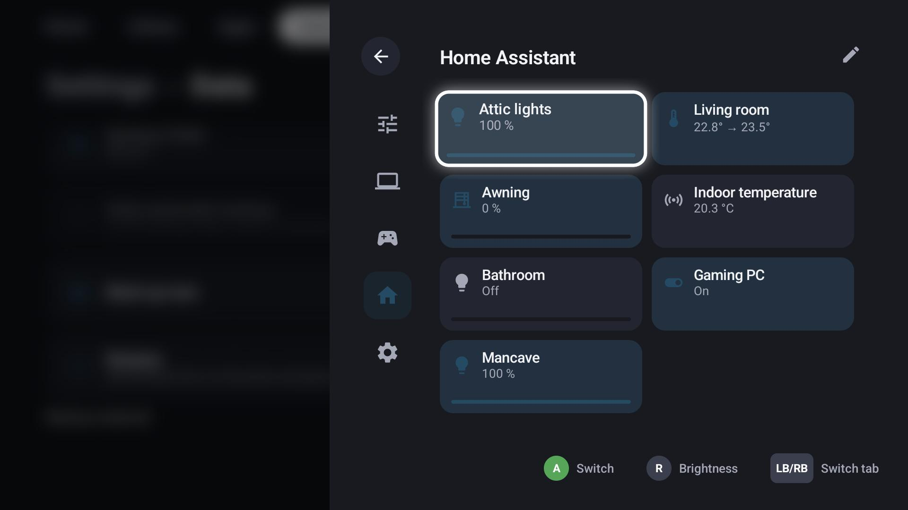
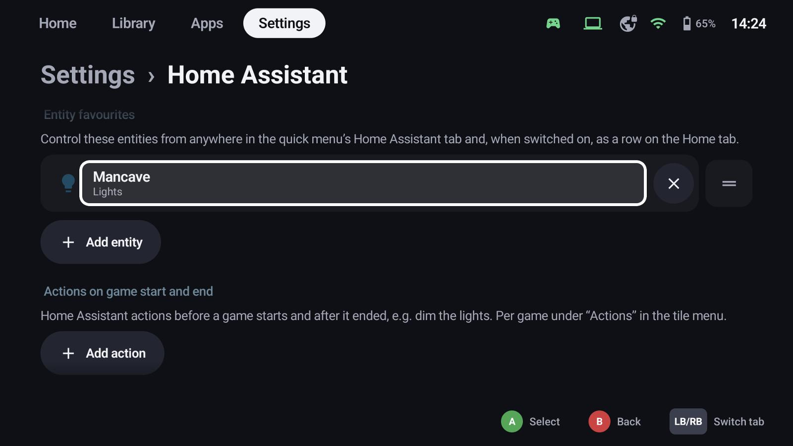
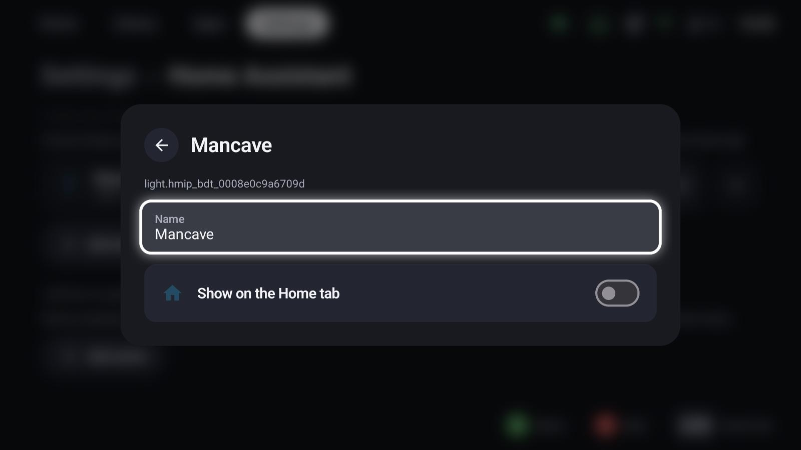
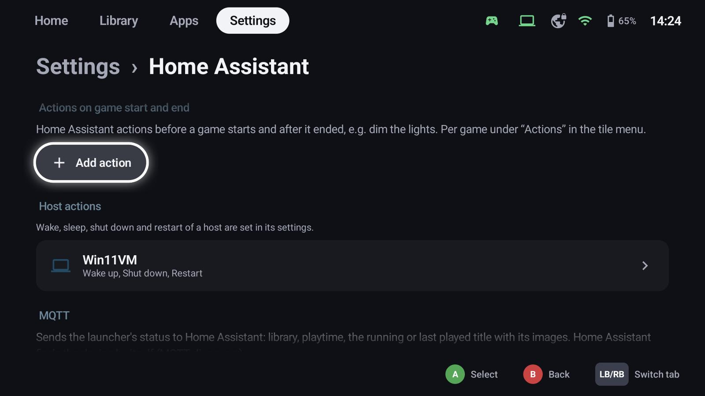
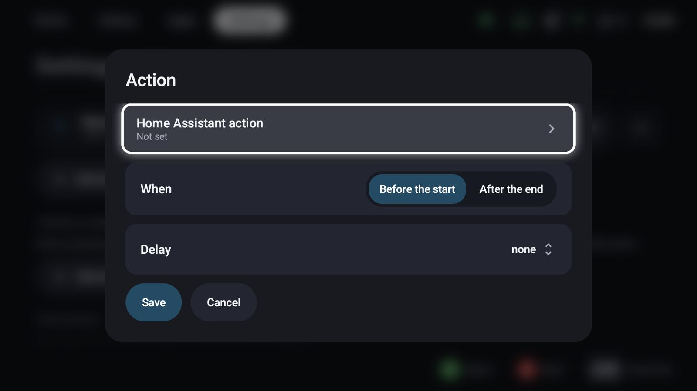
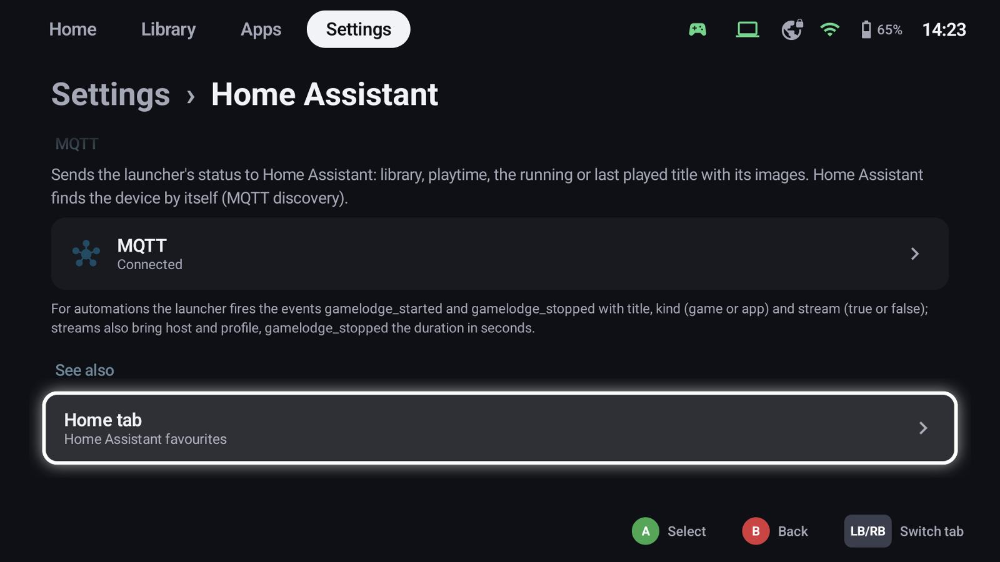

# Home Assistant

GameLodge connects to your [Home Assistant](https://www.home-assistant.io) to control your home from the
couch, to power your PCs on and off, and to let your home react to your games.

## Sign in

**Settings → Home Assistant**: enter the address of your Home Assistant and choose

- **Sign in here** – the login opens in the browser on this device, or
- **Sign in on the phone** – scan the QR code and sign in there (handy on a TV or handheld; the phone has to
  be in the same network).

GameLodge uses Home Assistant's normal login (OAuth); no token needs to be copied.

## Entity tiles

**Add entity** picks lights, switches, fans, buttons, scripts, scenes, automations, locks, media players,
sensors, covers and climate entities.
Tiles show in the quick menu's *Home Assistant* tab and, if you want, as a row on the Home tab.

- **A** switches or runs the entity; the right stick sets brightness, position or temperature.
- **✕** removes a tile, the handle reorders.
- Select a tile for its own settings:

{ width="600" }

  - **Name** – how the tile is called in GameLodge (empty: the name from Home Assistant)
  - **Show on the Home tab**

## Game actions

Run Home Assistant actions **before a game starts** and **after it ended** – dim the lights, switch on the
TV and the soundbar, start the air conditioning.

**Add action** – under *Actions on game start and end*, or per game with **X → Actions** on its tile:

{ width="600" }

- **Home Assistant action**: any action (script, scene, light, switch …)
- **When**: before the start or after the end
- **Delay**: none or a few seconds / minutes, and whether the game start waits for it

On the Windows host, actions can also run when *another device* starts a game on the PC through Vibepollo.

### Events for automations

For your own automations GameLodge fires `gamelodge_started` and `gamelodge_stopped` with the title, the kind
(game or app) and whether it's a stream; streams also bring the host and profile, `gamelodge_stopped` the
duration in seconds.

## Host actions

Wake up, sleep, shut down and restart of a host can use Home Assistant actions – for PCs without
Wake-on-LAN, a VM on a hypervisor or a PC behind a smart plug. Set them in the [host's settings](hosts.md#home-assistant-actions).

## MQTT status

With an MQTT broker (e.g. the Mosquitto app), GameLodge reports its status: library size, play time and the
running or last played title with its images. Every device appears as its own device in Home Assistant
(MQTT discovery).

- Broker address, port, user and password; the **device name** in Home Assistant
- **TLS**: the broker's certificate must be valid for its address; a **self-signed** certificate is pinned
  by its fingerprint, which you confirm on the first connection – a changed certificate is refused until
  you confirm it again.
