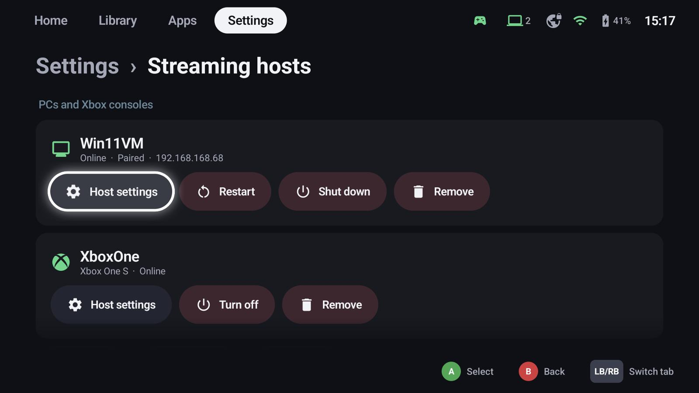
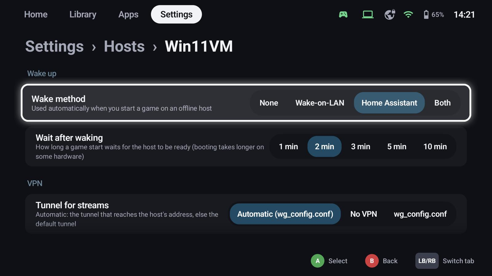
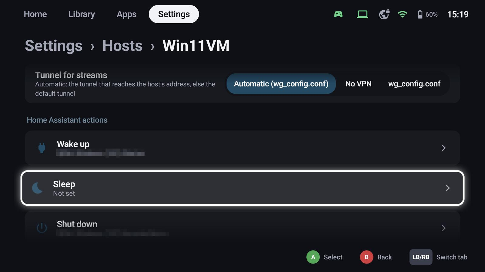
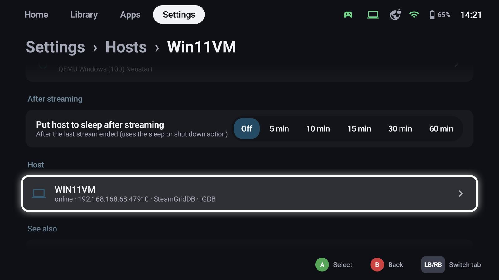

# Hosts & pairing

A host is a PC running Sunshine, Apollo or Vibepollo. GameLodge shows its apps in the library and streams
them.

## Add and pair a host

**Settings → Hosts** finds hosts in the same network while the page is open. For a host in another network
choose **Add host** and enter its address.

1. Select the host and choose **Pair**.
2. GameLodge shows a **PIN**. Open the host's web interface (Sunshine / Apollo / Vibepollo) and enter it.
3. The host's apps appear in the library a few seconds later.

The host card shows whether it's online and paired, with **Host settings**, **Restart**, **Shut down** and
**Remove**.

!!! tip "GameLodge on the PC too"
    If the PC also runs GameLodge for Windows, pair it under **Settings → Metadata & artwork → Add source**
    (or in the wizard's *GameLodge on the PC* step). The library then gets the PC's games with artwork,
    platform and play data, see [Sharing this PC](sharing.md).

## Host settings

### Wake-up

- **Wake method**: *Wake-on-LAN*, *Home Assistant* (an entity that powers the PC on – a smart plug, a VM, a
  BIOS wake), *Both* or *None*. Used automatically when you start a game on an offline host.
- **Wait after waking**: how long a game start waits for the host to be ready.

### VPN

**Tunnel for streams**: *Automatic* uses the tunnel that reaches the host's address, else the default
tunnel; or a fixed tunnel, or no VPN. See [VPN](vpn.md).

### Home Assistant actions

Wake up, sleep, shut down and restart can each run a Home Assistant action – for PCs without Wake-on-LAN
or a VM on a hypervisor. They are also offered in the quick menu's *Hosts* tab.

{ width="600" }

### After streaming

**Put host to sleep after streaming**: some time after the last stream ended, GameLodge runs the host's
sleep (or shut down) action. Starting another stream in time cancels it.

## Vibepollo

With [Vibepollo](https://github.com/Nonary/Vibepollo) and its API token, GameLodge can start apps directly,
quit them reliably and bring the running game's window to the front when you resume.
