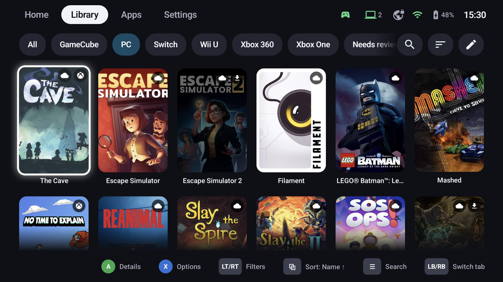
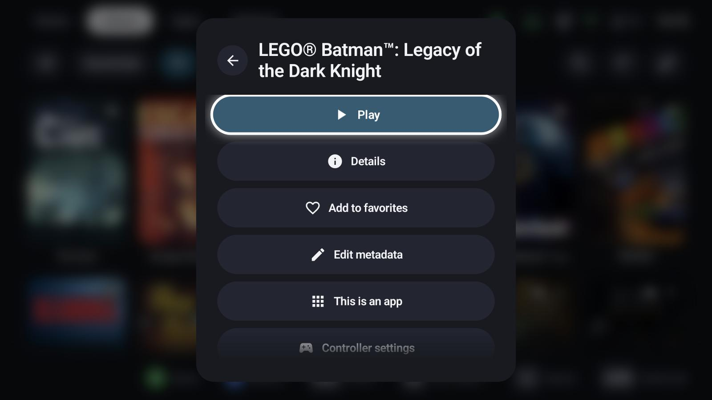
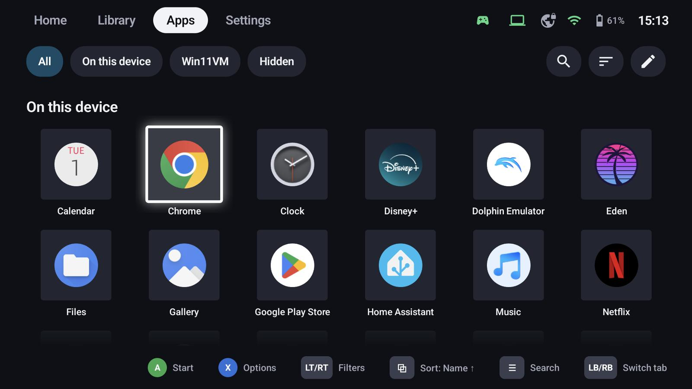
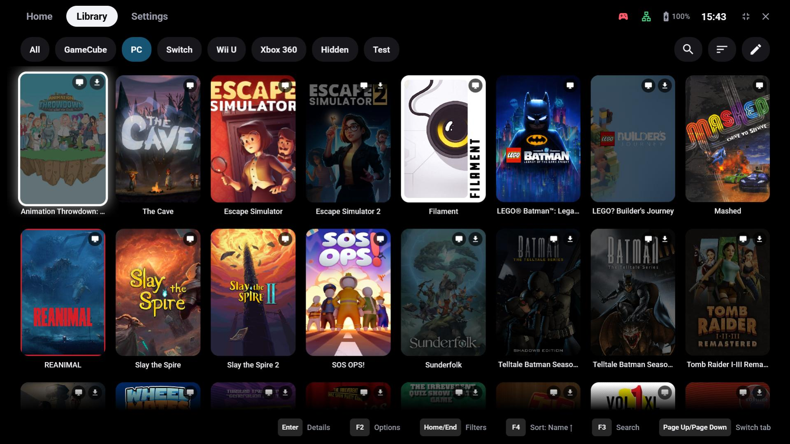

# Library

GameLodge has three tabs for your collection: **Home** with rows of your choice, **Library** for games
and **Apps** for everything else. Each entry knows how it starts – locally, through an emulator or as a
stream – and the same game from several sources appears once.

## Where games come from

| Source | Platform | What appears |
|---|---|---|
| Installed apps | Android | Apps and games of the device; games are recognised automatically (**X → This is an app / a game** corrects it) |
| Streaming hosts | Android, Windows | The apps of every paired Sunshine / Apollo / Vibepollo host; with a GameLodge host also their artwork, platform and play data – see [Hosts & pairing](hosts.md) |
| PC stores | Windows | Steam, Epic, GOG, Xbox, EA, Ubisoft, Battle.net, Amazon and Playnite libraries, plus games you add yourself – see [PC games](pc-games.md) |
| ROM folders | Android | Games from your ROM folders, started with an installed emulator – see [Emulators & ROMs](emulators.md) |

Games that aren't installed are dimmed; badges on the tiles show where a game comes from (Android, PC,
ROM, host).

## Navigating

| Button | Action |
|---|---|
| A | Details (games) or start (apps) |
| X | Options: play, details, favourite, metadata, groups, actions, hide … |
| LT / RT | Previous / next filter chip |
| LB / RB | Previous / next tab |
| Menu (≡) | Search |
| View (⧉) | Sort: name, last played, play time, rating, release year, time to beat |

{ width="600" }

## Apps tab

Everything that isn't a game: the device's apps on Android, apps of your hosts and – on Windows – programs
you added as apps. Chips split them by source; **X → This is a game** moves an entry to the library.

## On Windows

The Windows app looks and works the same; keyboard and mouse work alongside the controller (button hints
show the keys). Its local games come from the PC's stores, see [PC games](pc-games.md).

## More

- [Filters, groups & collections](filters.md) – chips, smart filters, split by platform, Home rows
- [Metadata & artwork](metadata.md) – sources, the editor, choosing artwork
- [Play time & statistics](playtime.md) – where play time comes from, shared between devices
- [Home tab & tiles](appearance.md) – layouts, tile shapes and sizes per tab
