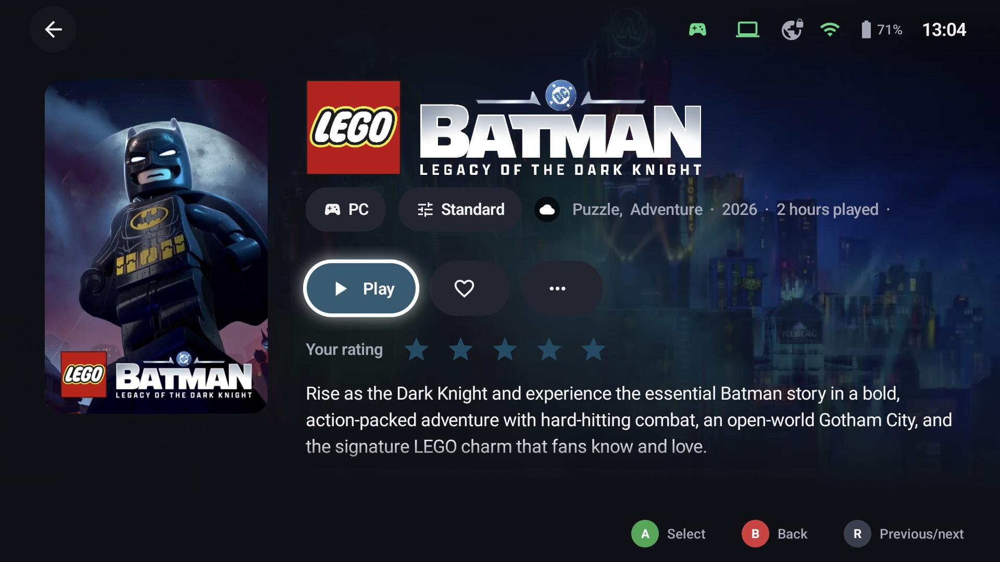
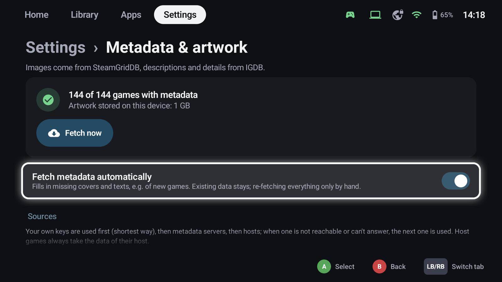
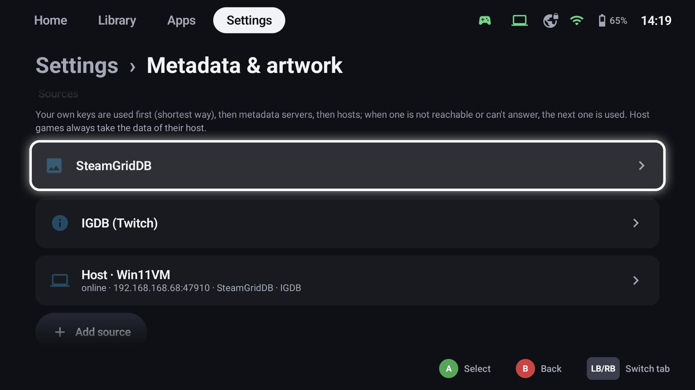
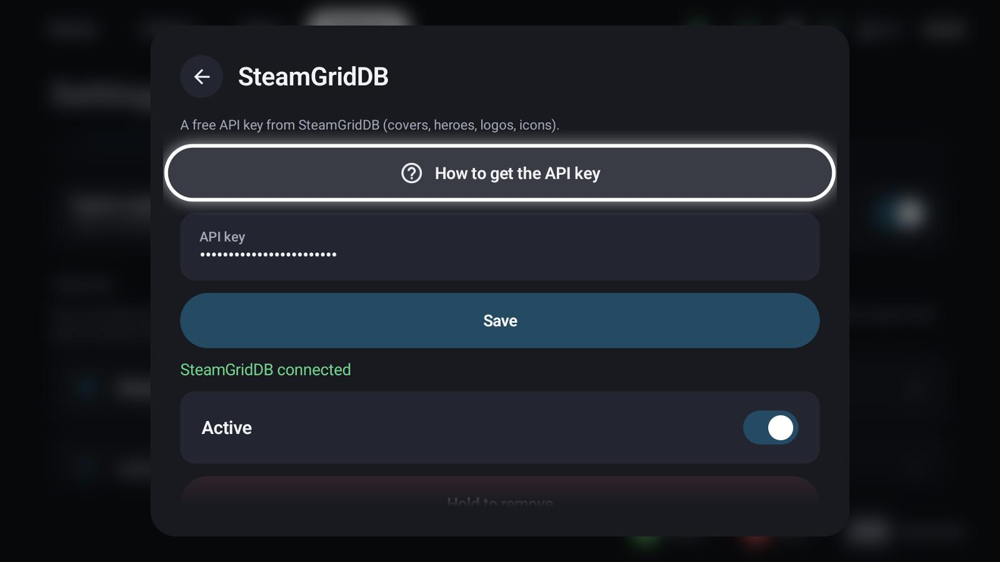
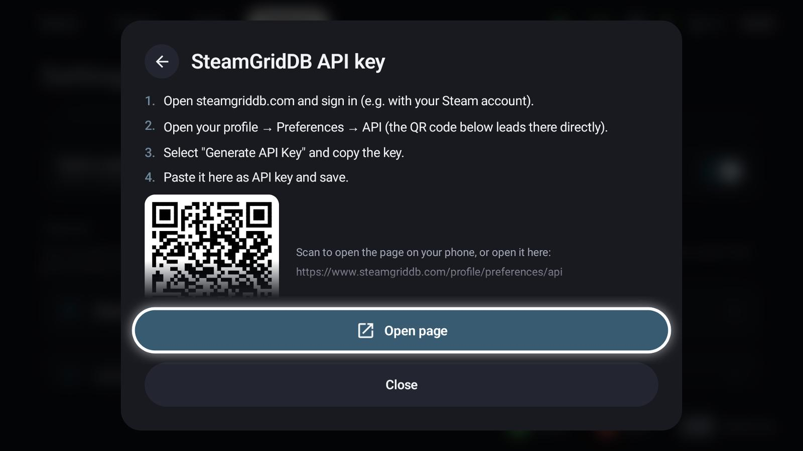
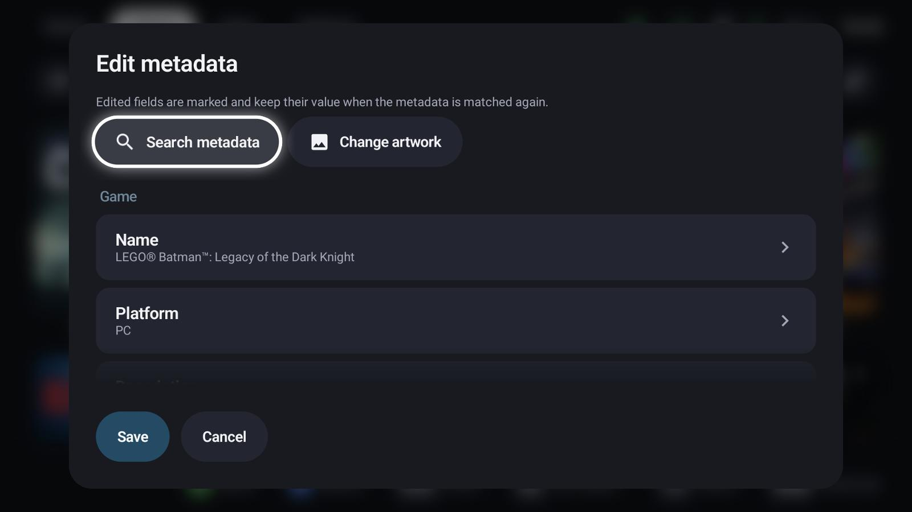
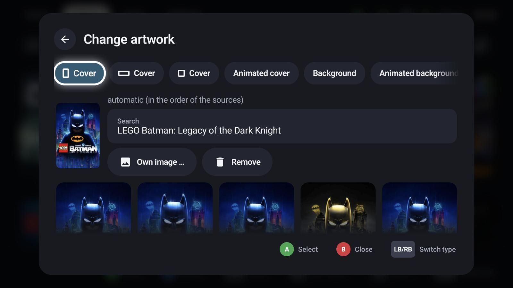

# Metadata & artwork

GameLodge fills in descriptions, genres, release years, ratings and artwork – covers in three shapes,
backgrounds (heroes), logos, icons and animated artwork – for every game and app.

## Sources

**Settings → Metadata & artwork** shows how many games have metadata and how much artwork is stored.
**Fetch metadata automatically** fills in what's missing for new games; existing data stays.

| Source | Provides | What you need |
|---|---|---|
| Store / host data | What the store or the host already knows | Nothing |
| [SteamGridDB](https://www.steamgriddb.com) | Covers, backgrounds, logos, icons, animated artwork | A free API key |
| [IGDB](https://www.igdb.com) | Descriptions, genres, ratings, release dates, time to beat, covers | Client ID and secret of a free Twitch developer app |
| Metadata server | SteamGridDB and IGDB through a server with your keys | A paired [metadata server](https://github.com/thecodingdad/gamelodge/tree/main/server) |
| GameLodge host | The keys and artwork of your Windows PC | A paired GameLodge host |

Your own keys are used first, then metadata servers, then hosts; when one can't answer, the next one is
asked. Host games always take the data of their host. Each key dialog has a **step-by-step guide with a QR
code**, so you can create the key on your phone.

**Send keys to hosts** shares your keys with GameLodge hosts that allow it (on the host: *Devices &
pairing*), so you only enter them once.

## The metadata editor

**X → Edit metadata** on a tile opens the editor:

{ width="700" }

- **Search metadata** – look the game up under another name and pick the right match
- **Change artwork** – choose each kind of artwork yourself
- Every field (name, platform, description, genres, developer, year …) can be edited. Edited fields are
  marked and **keep their value** when the metadata is looked up again.
- **Save** or **Cancel** applies to everything in the editor at once.

### Choosing artwork

{ width="700" }

The chips switch between portrait cover, landscape cover, square cover, animated cover, background,
animated background, logo and icon. *Automatic* takes the first source in order; select any image to
use it instead, search under another name, add **your own image** from the device, or **remove** one.

## Uncertain matches

When GameLodge isn't sure which game a title is, the match lands in the **review list** (shown on the
settings page while there are any): confirm it or pick the right game.

## Animated artwork

Animated covers and backgrounds play when a tile is focused – or always, if you prefer
(*Library tab* and *Home tab* settings). Touch never animates tiles, and they only download on unmetered
networks unless you allow it.

## Maintenance

- **Re-fetch all** looks up all automatically found metadata again; your corrections stay.
- **Settings → Data** shows the storage used by artwork and can delete and download it again.

## See also

- [Library](library.md)
- [Your PC as host](pc-host.md) – artwork through the PC's keys
- [Backup & restore](backup.md) – what happens to artwork in a backup
- [Setup wizard](wizard.md) – key guides with QR codes
