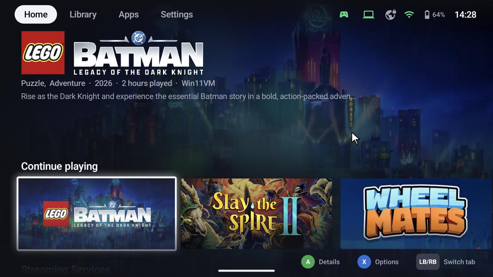
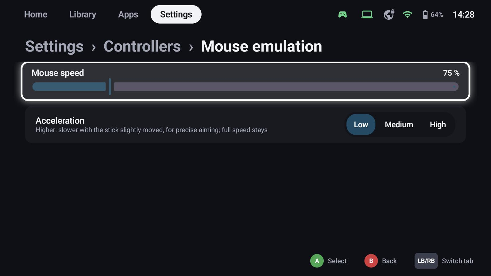

# Mouse emulation

Some games, launchers and Windows dialogs need a mouse. With mouse emulation the controller moves a
pointer – GameLodge's own on the device, the host's mouse in a stream.

## On and off

Hold **Select** (default, see [shortcuts](controllers.md#button-shortcuts)) to switch it on, hold it again
to switch it off. It's also in the quick menu's stream controls.

| Input | Action |
|---|---|
| Left stick | Move the pointer |
| Right stick | Scroll |
| A | Left click |
| B | Right click |
| X | Middle click |
| LB / RB | Back / forward |

## Speed

**Settings → Controllers → Mouse emulation**:

- **Mouse speed** in percent of the default
- **Acceleration**: higher values move slower while the stick is only slightly moved, for precise aiming;
  full speed stays the same

The pointer uses at least a 15 % dead zone, so it doesn't drift with worn sticks.
