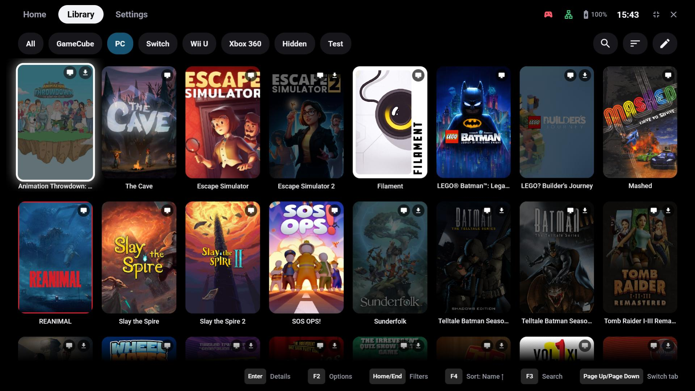
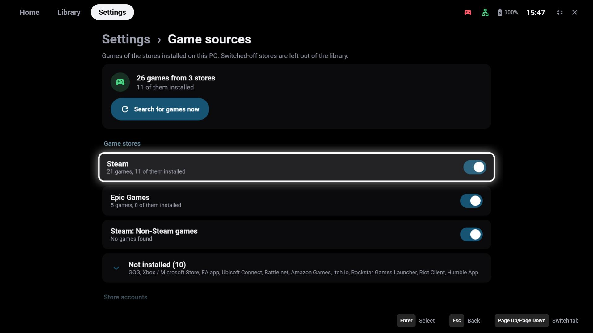
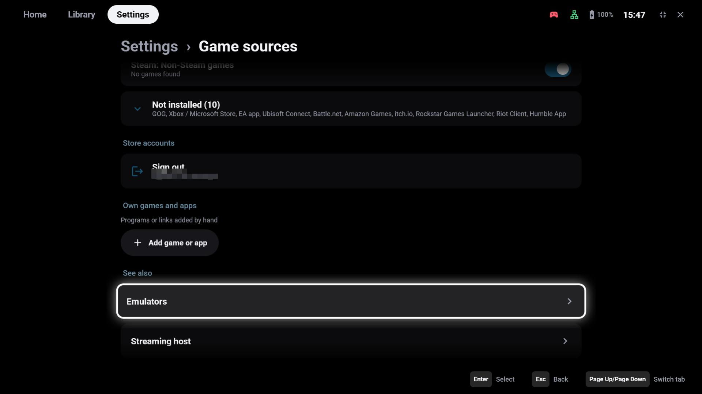
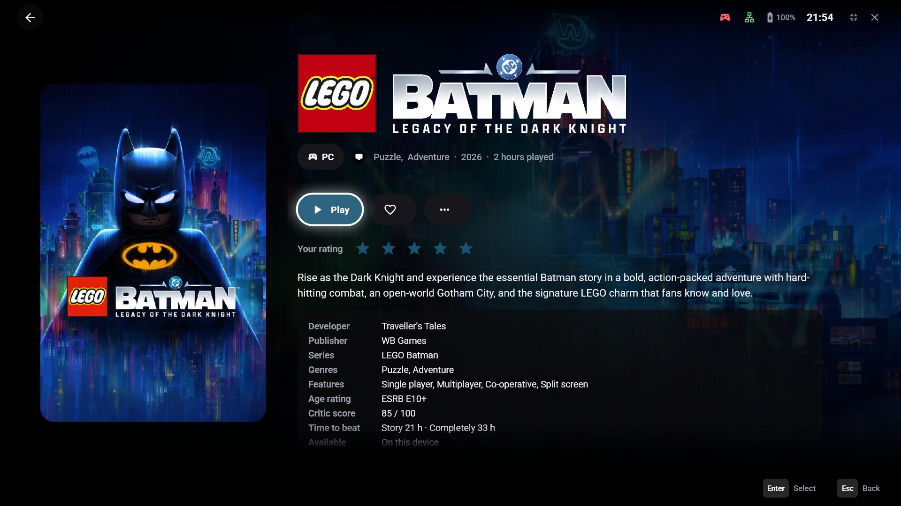

# PC games

On Windows GameLodge reads the game stores installed on the PC and shows their games next to your streams
and ROMs – one full-screen library for the whole PC.

!!! note "Windows only"
    This page is about the Windows app. On Android the library holds the device's apps and games, your
    [ROMs](emulators.md) and the games of your [streaming hosts](hosts.md) – which can be exactly these PC
    games, see [Your PC as host](pc-host.md).

## Game sources

**Settings → Game sources** lists the stores found on this PC. Switch a store off to leave its games out
of the library; **Search for games now** scans again (GameLodge also scans on start).

| Source | What appears |
|---|---|
| Steam | Installed games; signed in (below) every game you own |
| Steam: Non-Steam games | The shortcuts you added to Steam yourself |
| Epic Games, GOG, Xbox / Microsoft Store, EA app, Ubisoft Connect, Battle.net, Amazon Games, itch.io, Rockstar Games Launcher, Riot Client, Humble App | Installed games, and owned ones where the store keeps them locally |

Stores that aren't installed are collapsed under **Not installed**. Games that aren't installed are dimmed
in the library; starting one opens its store's installation.

## Steam account

Without an account GameLodge only knows the Steam games on this PC. **Store accounts → Sign in with the
Steam app** shows a QR code: open the Steam app on your phone, tap the shield (Steam Guard) and scan it.
Signed in, Steam lists every game you own – also those not installed and with a private profile.
**Sign out** removes the sign-in from this PC.

## Own games and apps

Programs that no store knows – an old game, a tool, a link – are added under **Own games and apps → Add
game or app**:

- **Name**, **program or link**, optional **arguments** and **working folder**
- **App instead of game** – shows it in the Apps tab
- **Hold to remove**

Emulators and ROM folders are set up on their own page, see [Emulators & ROMs](emulators.md#on-windows).

## Start actions

A game can start in more than one way. **X → Start actions** on its tile lists them:

- the **launch options of the store** (read only), and
- your **own start actions** – e.g. the game's launcher or settings program, a DX11 or VR variant, or a mod
  manager that starts the game with mods.

The **default** is used by a plain start; **Start with…** offers all of them – also to devices that stream
this game from the PC.

**Process names** (optional, separated by commas, e.g. `game.exe`) tell GameLodge which programs belong to
the game: it waits until they end before it stops the play time and ends a stream. Empty: the program
itself, or the game's known processes.

## Details and play time

The details page shows the store, genres, release year and play time like on Android; artwork and metadata
come from the same [sources](metadata.md). Play time is measured while the game's processes run, see
[Play time & statistics](playtime.md).
