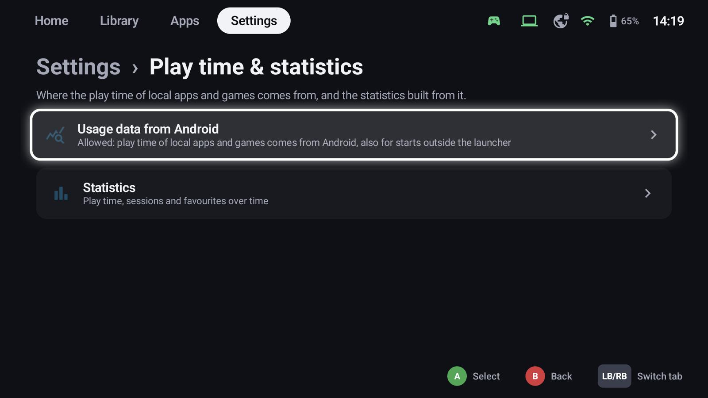
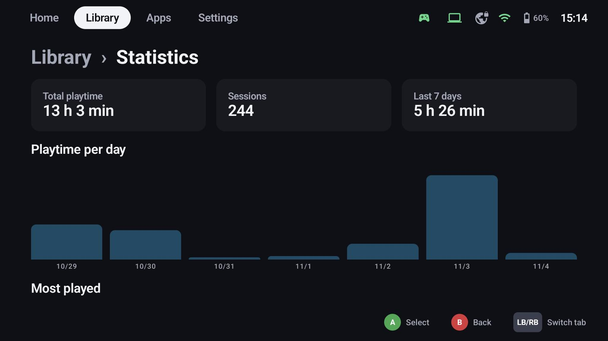

# Play time & statistics

GameLodge counts the time you play every game and app and shows it on the tiles, the details page and in
the statistics.

## Where play time comes from

| Source | Counts |
|---|---|
| GameLodge itself | Everything you start from GameLodge: local games, ROMs, streams |
| Android usage data | Also apps and games started outside GameLodge (needs usage access) |
| Your GameLodge host | The sessions of all your devices for the host's games |

**Settings → Play time & statistics → Usage data from Android** allows usage access. Without it GameLodge
only measures what it starts itself.

### Shared between devices

With a GameLodge host (the Windows app as [host](sharing.md)), every device
sends its sessions of the host's games to the host and reads the others' – so the handheld, the tablet and
the PC all show the same total, and sessions recorded offline are sent later. Ratings, favourites,
hidden flags and groups travel the same way.

## Statistics

**Settings → Play time & statistics → Statistics** shows:

- total play time, number of sessions and the last 7 days,
- play time per day,
- your most played games and apps, and your recent sessions.

The details page of a game shows its play time and when you played it last; tiles can show it as extra
info (*Library tab* settings → *Extra info*).
