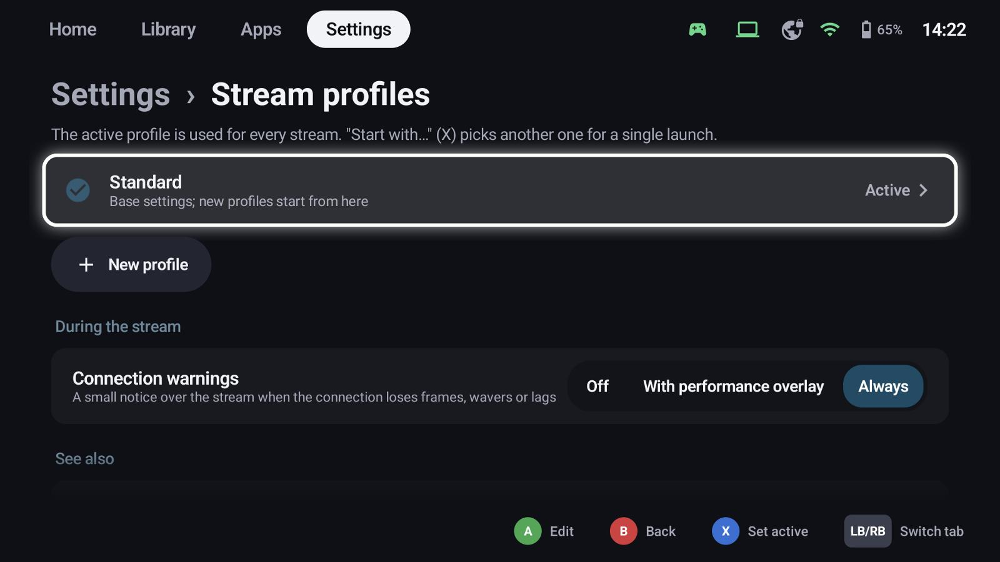
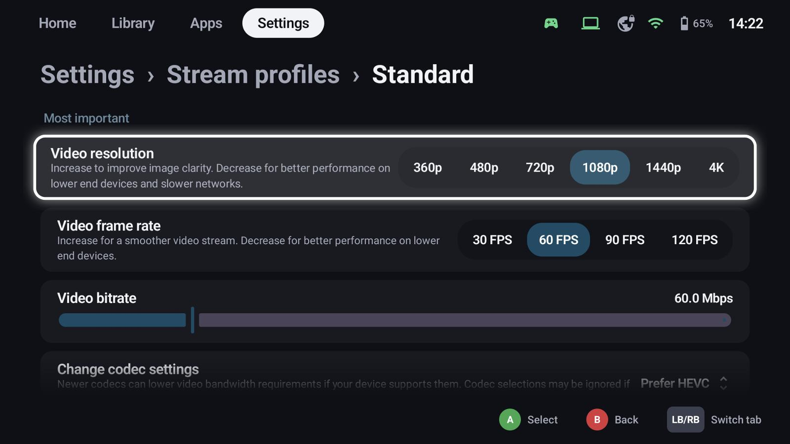

# Stream profiles

A stream profile is a set of stream settings: resolution, frame rate, bitrate, codec, HDR and more. Each profile
has a **PC** part and – once an [Xbox console](xbox.md) is added – an **Xbox** part; the profile editor shows them
as tabs (LT/RT switch them). The profiles are a group of **Settings → Streaming hosts**.

## Base settings and profiles

- **Standard** holds the base settings; new profiles start from it.
- **New profile** creates another one, e.g. *TV 4K HDR* or *Mobile data*.
- The **active** profile (X: *Set active*) is used for every stream.
- Before starting a game, switch the active profile in the game's details (profile button or LB/RB).
  **Start with…** (X on a tile) picks another profile for a single launch. Both work the same for PC and Xbox games.

## The most important settings

| Setting | Notes |
|---|---|
| Video resolution | 360p to 4K; lower for weak networks or devices |
| Video frame rate | 30 to 120 FPS |
| Video bitrate | Higher is sharper, needs a better network |
| Codec | H.264, HEVC or AV1, if the device and the host support them |
| HDR | Needs a host GPU with HEVC Main 10 encoding |
| Virtual display | Apollo / Vibepollo create a display matching your resolution and frame rate |
| Frame pacing | Balance between latency and smoothness |

Further down: audio, touch and mouse behaviour, on-screen controls and more – the full set of the built-in
streaming client.

## Xbox

The Xbox tab holds the settings for [Xbox streams](xbox.md#stream-settings): resolution, bitrate limit, sharpening,
picture fit and vibration. Profiles from before the Xbox tab take these from **Standard** until you change them.

## During the stream

**Connection warnings** show a small notice over the stream when the connection loses frames, wavers or
lags – always, only with the performance overlay, or never.

## See also

- [Hosts & pairing](hosts.md)
- [Xbox consoles](xbox.md)
- [Controllers & shortcuts](controllers.md) – controllers in the stream
- [Quick menu](quick-menu.md) – stream controls during the game
- [TV mode & screensaver](tv.md) – resolution on a TV
