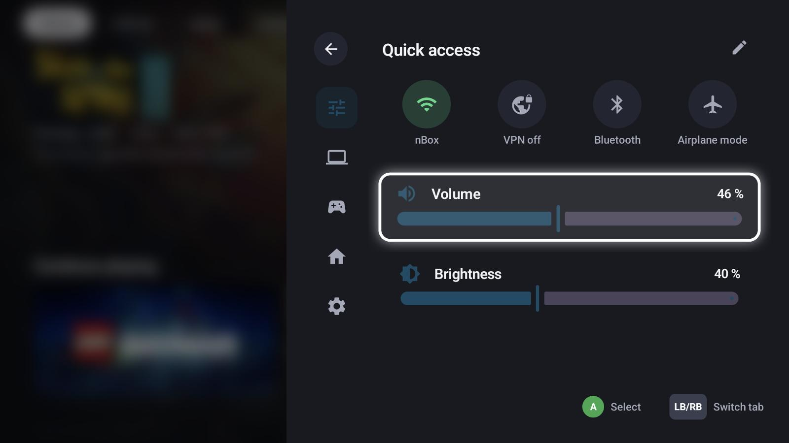
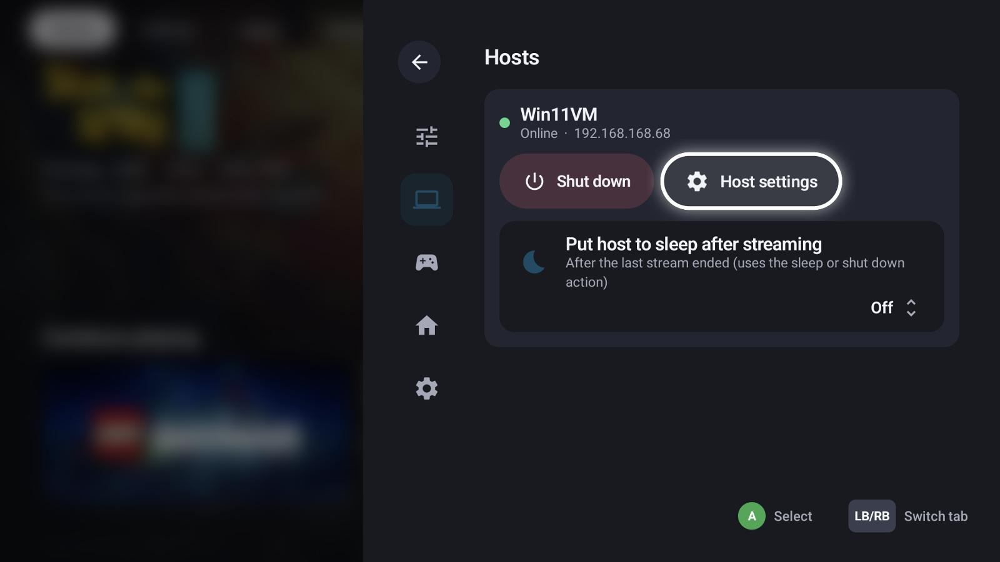
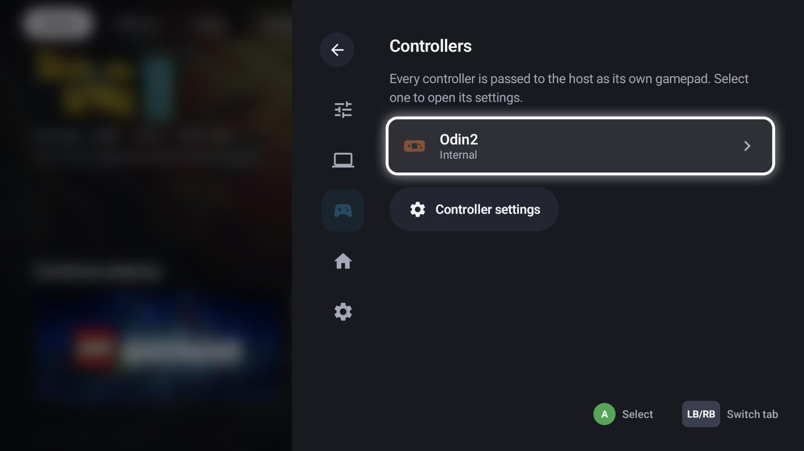
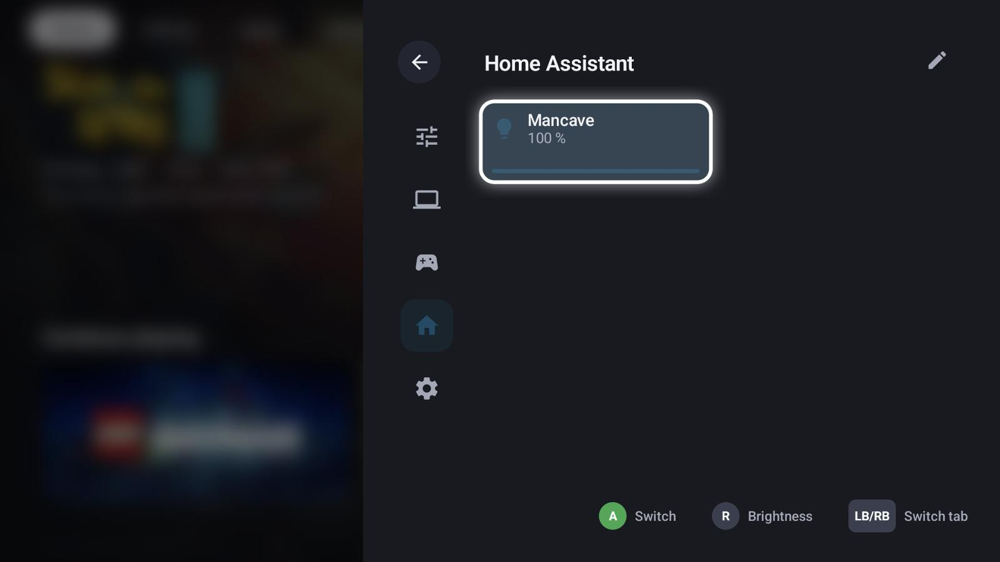
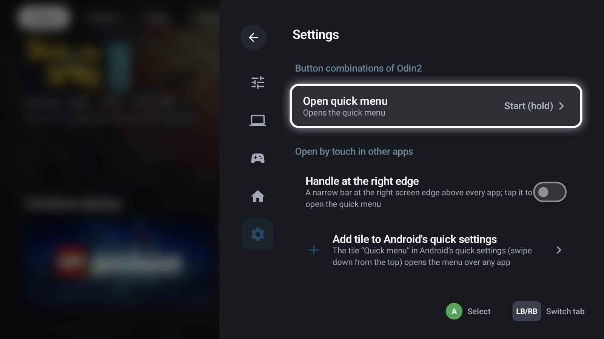
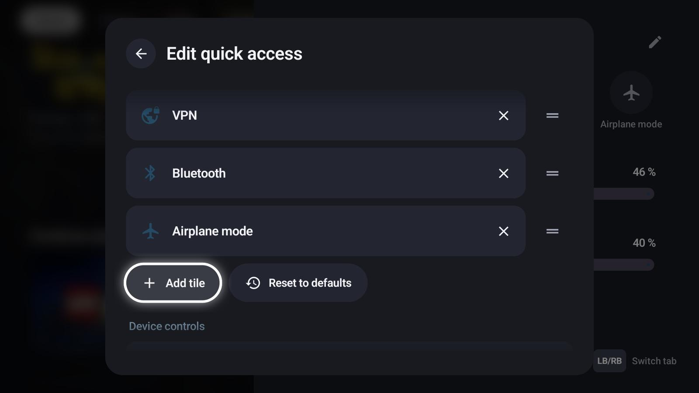

# Quick menu

The quick menu opens over everything – GameLodge, a game or a stream – with **Start (hold)** by default.
**LB / RB** switches its tabs, **B** closes it.

## Tabs

=== "Quick access"

    

    Toggles (Wi-Fi, VPN, Bluetooth, airplane mode …), volume and brightness. Running background tasks show
    here too.

    - **Android**: Wi-Fi, Bluetooth, airplane mode and the [VPN](vpn.md); volume and brightness. On the
      AYN Odin the TV output mode is in the Odin settings ("Video output mode").
    - **Windows**: volume, the audio output device and – where the display can be dimmed – brightness.

=== "Hosts"

    

    Your hosts with wake-up, shut down, their settings and auto sleep.

=== "Controllers"

    

    Connected controllers; select one for its settings.

=== "Home Assistant"

    

    Your entity tiles, see [Home Assistant](home-assistant.md). The pencil edits them.

=== "Settings"

    

    The quick menu's own shortcut, and ways to open it by touch in other apps.

While a game or stream runs, a **Running** tab comes first: resume, quit, and the stream controls
(on-screen keyboard, mouse emulation, performance overlay, disconnect).

## Edit quick access

The pencil on the *Quick access* tab edits its toggles:

{ width="600" }

Remove tiles with ✕, reorder them with the handle, **Add tile** for more, **Reset to defaults**. Below,
*Device controls* chooses which sliders show.

## Opening it without a controller

- **Handle at the right edge** (Android): a narrow bar at the right screen edge above every app; tap it.
- **Tile in Android's quick settings**: add "Quick menu" to the quick settings you pull down from the top.
- A **keyboard shortcut** under *Touch, mouse & keyboard* (system-wide on Windows).

## Tasks

Metadata lookups, artwork downloads, scans, backups and restores run in the background. The status bar shows
a spinner while any runs; the task list shows each with its progress. A backup (and a restore while it still
unpacks) can be cancelled there.
