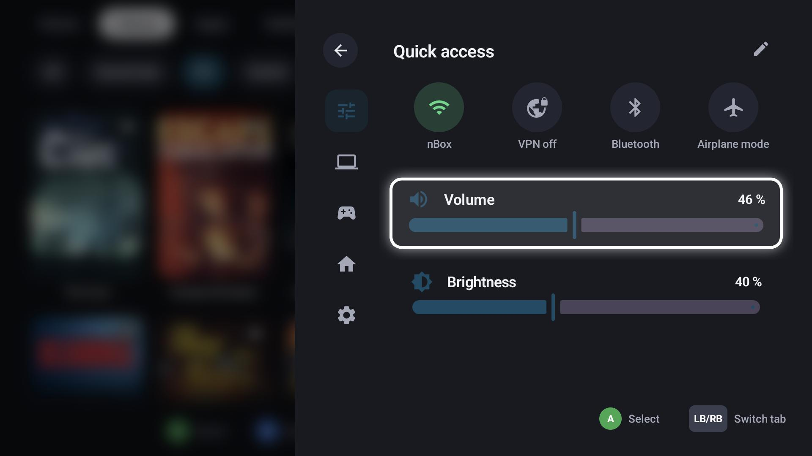

# Quick menu

The quick menu opens over everything – GameLodge, a game or a stream – with **Start (hold)** by default.
**LB / RB** switches its tabs.

| Tab | Content |
|---|---|
| Running | The running game or stream: resume, quit, stream controls (keyboard, mouse, overlay, disconnect) |
| Quick access | Toggles (Wi-Fi, VPN, Bluetooth, airplane mode, …), volume and brightness; the pencil edits the toggles |
| Hosts | Your hosts with wake-up, shut down and their settings |
| Controllers | Connected controllers, their settings |
| Home Assistant | Your entity tiles (see [Home Assistant](home-assistant.md)) |
| Settings | Shortcuts into the settings |

Background tasks – metadata lookups, downloads, backups – show in a task list with their progress;
some can be cancelled there.
