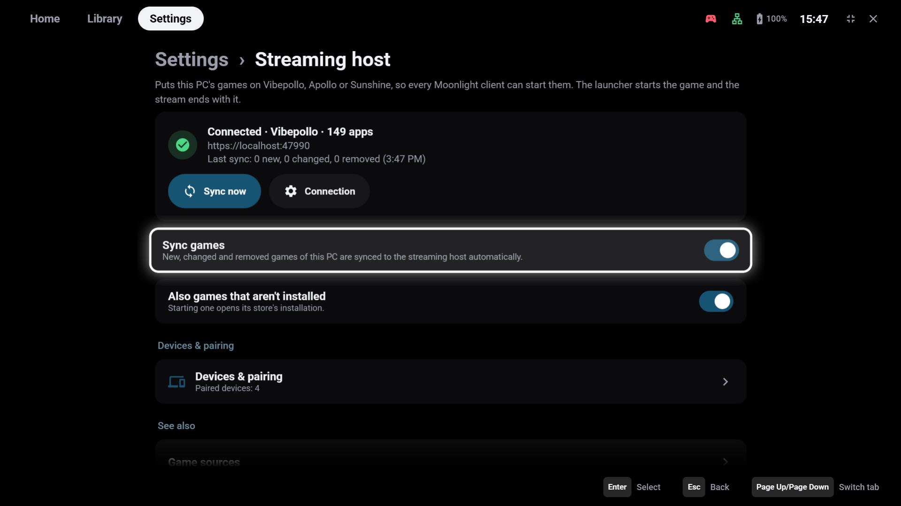
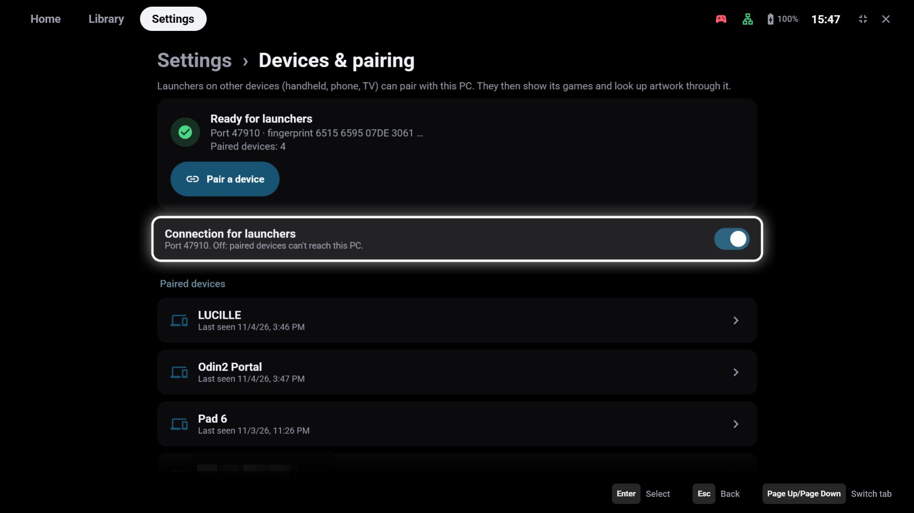
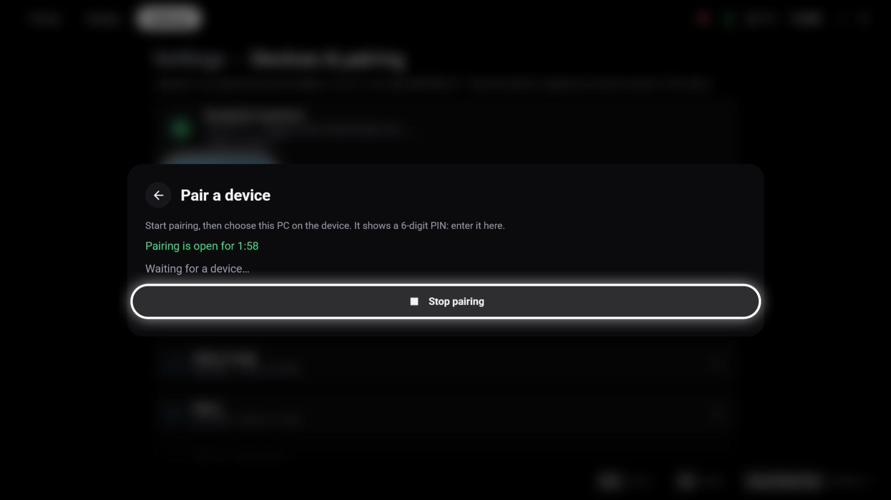
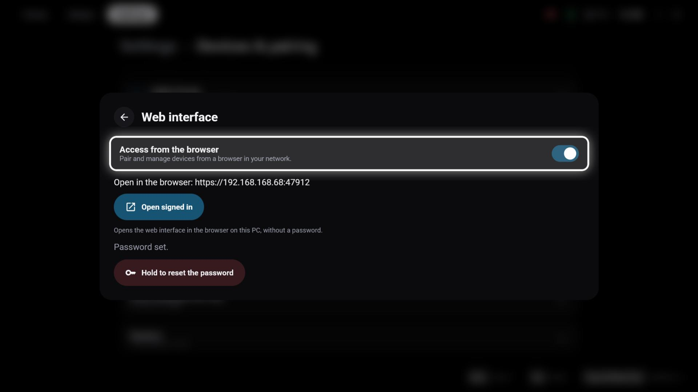
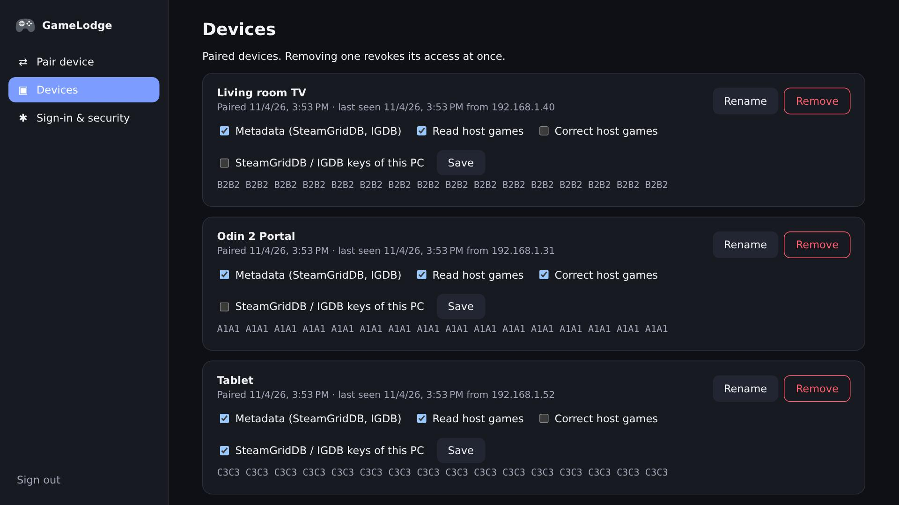
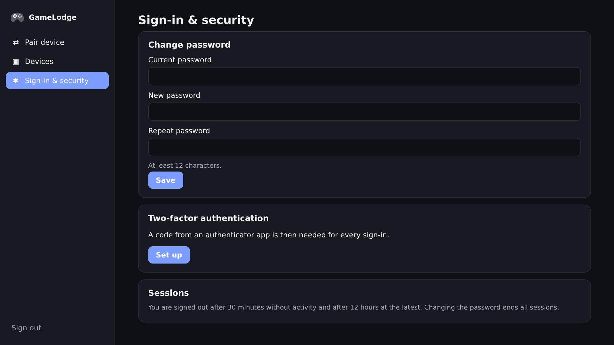

# Sharing this PC

A Windows PC with GameLodge can share its games with your other GameLodge devices – a handheld, a tablet, a
TV. The PC becomes a **GameLodge host**: it puts its games on its streaming server and hands their artwork,
metadata and play data to every paired device.

!!! note "Windows only"
    The host role needs the Windows app on the PC that streams. Devices that use it can be Android or
    Windows.

## Streaming host

If the PC runs [Vibepollo](https://github.com/Nonary/Vibepollo), [Apollo](https://github.com/ClassicOldSong/Apollo)
or [Sunshine](https://github.com/LizardByte/Sunshine), **Settings → Streaming host** puts the PC's games
on it as apps – so every Moonlight client can start them, with or without GameLodge. GameLodge starts the
game and the stream ends with it.

- **Connection** – the address of the streaming server's web interface and its login (`https://localhost:47990` by default)
- **Sync games** – new, changed and removed games are synced automatically; **Sync now** does it at once
- **Also games that aren't installed** – starting one opens its store's installation

With Vibepollo, the Windows app also runs your Home Assistant [game actions](home-assistant.md#game-actions)
when *another* device starts a game on the PC.

## Devices & pairing

**Settings → Streaming host → Devices & pairing** pairs your other GameLodge devices with this PC:

1. Press **Pair a device** on the PC – pairing stays open for two minutes.
2. On the device, open **Settings → Metadata & artwork → Add source** (or the wizard's
   [GameLodge on the PC](wizard.md#9-gamelodge-on-the-pc) step) and choose this PC.
3. The device shows a 6-digit PIN: enter it on the PC.

{ width="600" }

**Connection for launchers** switches the host role on or off (port 47910); off, paired devices can't
reach the PC. Select a paired device to rename it, change what it may do or remove it.

Only paired devices get any access, and every pairing needs the PIN confirmed on the PC.

## What paired devices get

| | |
|---|---|
| Games | The PC's games with their artwork, platform and metadata, already matched |
| Play data | Play time, ratings, favourites and collections, shared between all devices |
| Metadata | Artwork lookups through the PC's SteamGridDB / IGDB keys – the device needs no keys of its own |
| Keys | Optional: get and change the PC's SteamGridDB / IGDB keys |
| Streaming | The Guide button stays on the device while streaming; resuming brings the game's window to the front |

## Web interface

**Devices & pairing → Web interface** lets you pair and manage devices from a browser in your network – handy
when the PC sits under the TV.

{ width="600" }

- **Access from the browser** – on or off; the address is shown below (`https://<PC>:47912`)
- **Open signed in** – opens it in the browser on this PC, without a password (also in the tray menu)
- First use from another device: enter the **setup code** shown in the launcher and choose an admin
  password; **Hold to reset the password** starts over

The browser pages pair devices, rename them, set their permissions and remove them. **Sign-in & security**
changes the password and sets up **two-factor authentication** with an authenticator app; sessions end after
30 minutes without activity and after 12 hours at the latest.

The web interface only answers from private networks and uses the PC's own certificate – your browser asks
you to trust it once.

!!! tip "Keep GameLodge running"
    Host features need GameLodge to run on the PC. With **Keep running in the tray** (see
    [Getting started](getting-started.md#window-startup-windows)) it keeps working with the window closed.
