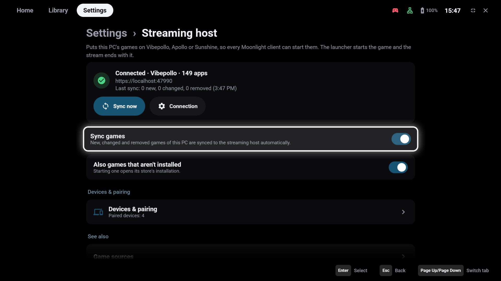
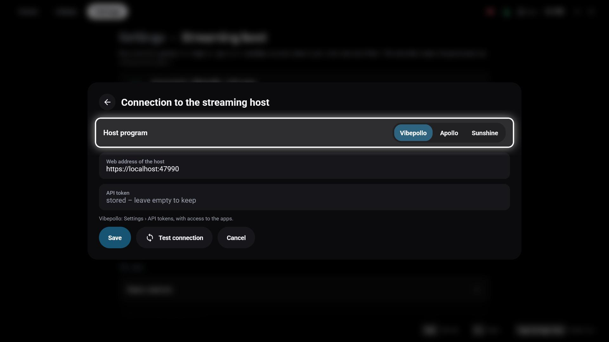

# Streaming host

**Settings → This PC as host** puts the games of this PC on its streaming server – Vibepollo, Apollo or
Sunshine – as apps. Every Moonlight client can then start them, with or without GameLodge: the app entry
starts the game through GameLodge, and the stream ends when the game ends.

!!! note "Windows only"
    This page is about the Windows app on the PC that streams. To stream *from* a PC, see
    [Hosts & pairing](hosts.md).

## Before you start

- Install [Vibepollo](https://github.com/Nonary/Vibepollo) (recommended),
  [Apollo](https://github.com/ClassicOldSong/Apollo) or [Sunshine](https://github.com/LizardByte/Sunshine) on
  the PC and open its web interface once to set it up.
- Keep GameLodge running on the PC – with **Keep running in the tray** (see
  [Getting started](getting-started.md#window-startup-windows)) the window can stay closed.

## Connection

**Connection** opens the access to the host program:

{ width="700" }

| Field | Vibepollo | Apollo | Sunshine |
|---|---|---|---|
| **Host program** | Vibepollo | Apollo | Sunshine |
| **Web address of the host** | `https://localhost:47990` by default – the address of its web interface | same | same |
| **Login** | **API token** | user name and password of the web interface | user name and password of the web interface |

### Vibepollo API token

1. Open Vibepollo's web interface (`https://localhost:47990`) and sign in.
2. Go to **Settings → API tokens** and create a token with access to the **apps**.
3. Copy the token into **API token** in GameLodge.

A stored token or password isn't shown again; leave the field empty to keep it.

**Test connection** checks the access before you save. The card at the top of the page then shows the
state:

| State | Meaning |
|---|---|
| **Connected** · program · number of apps | Everything works |
| **Not set up** | No address or login yet |
| **Sign-in failed** | The host rejects the token or user name and password |
| **Not reachable** | The host program isn't running, or the address is wrong |
| **The host answered with error …** | The host refused the request – see the GameLodge log |

## Syncing games

- **Sync games** – new, changed and removed games of this PC are synced automatically.
- **Sync now** – syncs at once; the card shows the result (*new*, *changed*, *removed*).
- **Also games that aren't installed** – they appear on the host too; starting one opens its store's
  installation.

Each app gets the game's name and cover. GameLodge only touches the app entries it created itself – apps you
added to the host by hand stay as they are – and keeps a backup of the host's app list before each change.
Games of a store whose last scan failed aren't removed.

!!! tip "Start actions"
    A game's [start actions](pc-games.md#start-actions) are offered to devices that stream it from this PC too.

## Home Assistant on the host

With Vibepollo, the Windows app also runs your Home Assistant [game actions](home-assistant.md#game-actions)
when *another* device starts a game on this PC – also a plain Moonlight client.

## Next step

Pair your handheld, tablet or TV with this PC to give them the PC's artwork, metadata and play data:
[Devices & web interface](sharing.md).

## See also

- [Hosts & pairing](hosts.md) – streaming from the PC on your devices
- [PC games](pc-games.md) – game sources and start actions
- [Home Assistant](home-assistant.md) – game actions on the host
