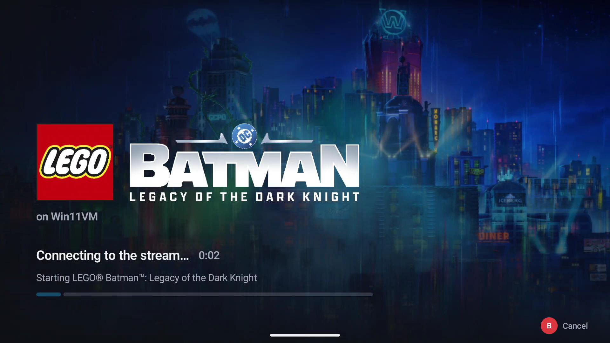
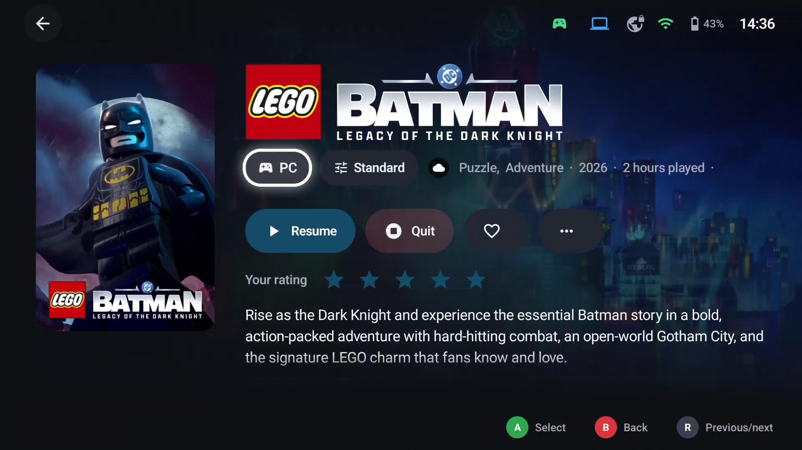

# Streaming

GameLodge streams games from PCs running [Sunshine](https://github.com/LizardByte/Sunshine),
[Apollo](https://github.com/ClassicOldSong/Apollo) or [Vibepollo](https://github.com/Nonary/Vibepollo). The streaming client is built in:
[Artemis](https://github.com/ClassicOldSong/moonlight-android) on Android, Moonlight on Windows – you never
leave GameLodge's interface.

| Page | What it covers |
|---|---|
| [Hosts & pairing](hosts.md) | Finding and pairing hosts, wake-up, sleep, host actions, Apollo & Vibepollo permissions |
| [Stream profiles](profiles.md) | Resolution, frame rate, bitrate, HDR, per-launch profiles |
| [VPN (WireGuard)](vpn.md) | Streaming away from home, Android only |

Setting up the PC you stream from – its games on Vibepollo, Apollo or Sunshine, and pairing your devices with
it – is under [Your PC as host](pc-host.md). Controllers and the quick menu in a stream are under
[Controls](controls.md).

## Starting a stream

Select a host game and press **A** (or **Play** on its details page). GameLodge

1. wakes the host if it's offline (and connects the VPN first if needed),
2. starts the game with the active stream profile,
3. attaches your controllers in player order,
4. measures the play time and runs your Home Assistant [game actions](home-assistant.md#game-actions).

**Back to GameLodge** (Guide) leaves the stream running in the background; selecting the game again
resumes it. The quick menu's *Running* tab resumes or quits it.

