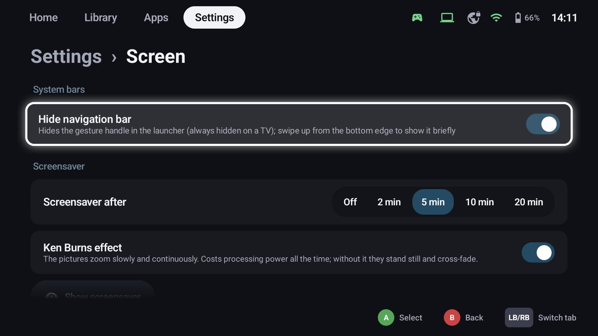
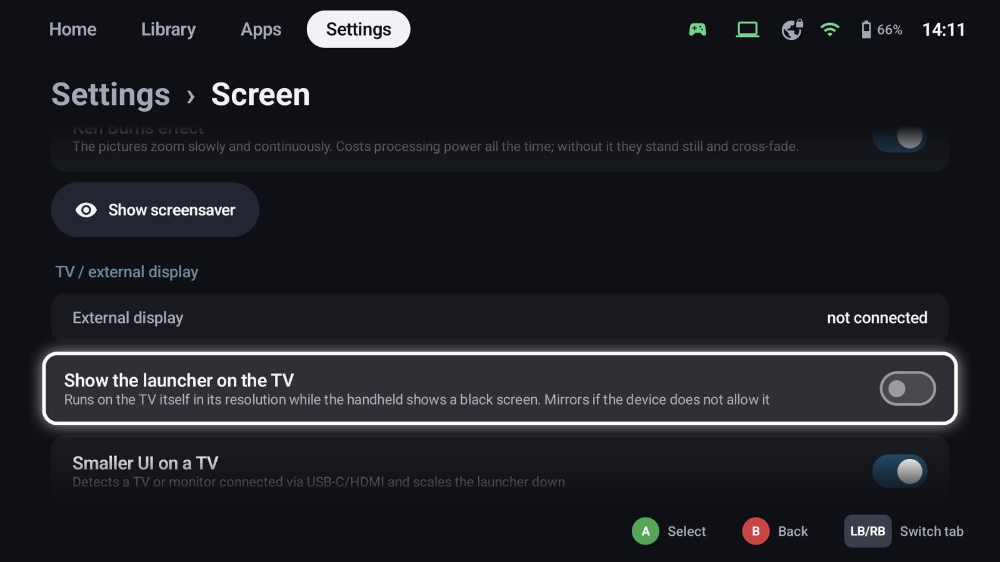

# TV mode & screensaver

**Settings → Screen** holds the system bars, the screensaver and the TV settings.

## System bars (Android)

**Hide navigation bar** hides the gesture handle in the launcher; swipe up from the bottom edge to show it
briefly. On a TV it's always hidden.

## Screensaver

After a while without input, GameLodge shows the artwork of your games full screen and keeps the display
awake.

- **Screensaver after**: off, 2, 5, 10 or 20 minutes
- **Ken Burns effect**: the pictures zoom slowly; without it they stand still and cross-fade (costs less
  power)
- **Show screensaver** tries it right away

Any button, touch or key ends it.

## TV / external display

Connect the handheld to a TV or monitor (USB-C / HDMI, a dock):

- **External display** shows whether one is connected and its mode.
- **Show the launcher on the TV**: GameLodge runs on the TV in its resolution while the handheld shows a
  black screen (it mirrors if the device doesn't allow that).
- **Smaller UI on a TV**: scales the launcher down for the bigger screen, automatically or with your own
  factor.
- **Resolution**: *Automatic* draws up to 1080p at a high refresh rate and lets the TV scale up – the
  smoothest choice on handhelds. If the device can't keep up, GameLodge tells you.

!!! tip "AYN Odin"
    The TV's output mode is set in the Odin settings, *Video output mode*; connect the TV again afterwards.
