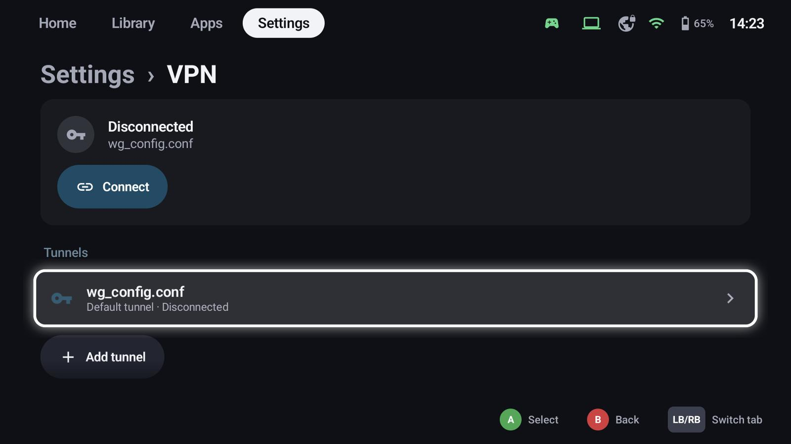
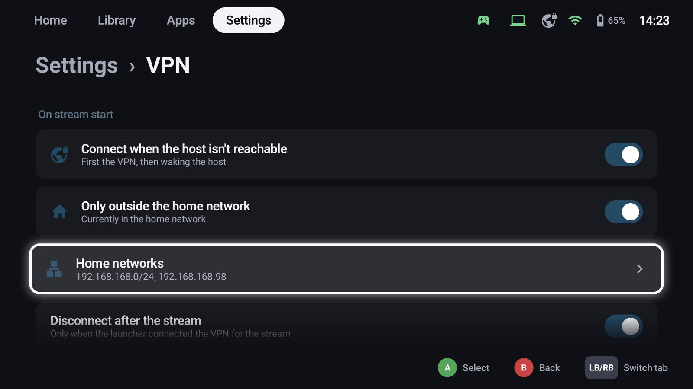
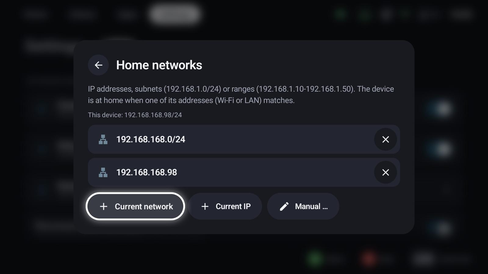

# VPN (WireGuard)

On Android, GameLodge has a built-in WireGuard VPN to stream from your hosts while you're away from home. It
connects only when it's needed.

## Add a tunnel

1. Export a WireGuard configuration (`.conf`) from your router or VPN server – on a FRITZ!Box under
   *Internet → Permit Access → VPN (WireGuard)*.
2. **Settings → VPN → Add tunnel** and pick the file.

The first tunnel is the **default tunnel**. The status card at the top connects or disconnects it by hand.

## Connect automatically

- **Connect when the host isn't reachable**: when you start a stream and the host can't be reached,
  GameLodge connects the VPN first, then wakes the host and starts the game.
- **Only outside the home network**: never connects at home. List your home networks:

{ width="600" }

  Add the **current network**, the **current IP** or enter addresses, subnets (`192.168.1.0/24`) or ranges
  (`192.168.1.10-192.168.1.50`) by hand. The device is at home when one of its addresses matches.
- **Disconnect after the stream** ends the tunnel again – only if GameLodge connected it for the stream.

## Per host

Each host chooses its tunnel in its [settings](hosts.md#vpn): *Automatic* (the tunnel whose allowed IPs
cover the host's address, else the default one), a fixed tunnel, or none.

!!! tip "Waking a host through the VPN"
    Wake-on-LAN packets usually don't pass a VPN. Use a Home Assistant entity as wake method for hosts you
    stream from away from home.

## See also

- [Hosts & pairing](hosts.md) – tunnel per host, wake-up
- [Quick menu](quick-menu.md) – VPN toggle in quick access
- [FAQ & troubleshooting](faq.md) – streaming away from home
