# Setup wizard

The setup wizard opens on the first start and walks you through the important settings. Every step except
language and controller layout can be skipped, and everything can be changed later. Run it again any time
from **Settings → System → Setup wizard**.

The steps below are the Android ones; on Windows some differ (startup, game sources, the PC as host).

## 1 · Welcome

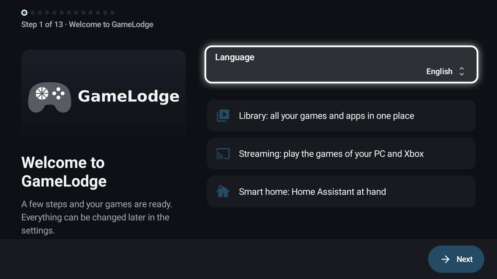

Choose the language – or **restore a backup** from another device. The backup path pairs your hosts first
and then restores (see [Backup & restore](backup.md#moving-to-a-new-device)).

## 2 · Controller

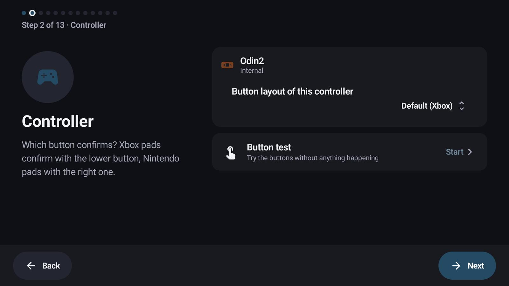

The button layout of your controller: Xbox pads confirm with the lower button, Nintendo pads with the right
one. **Button test** lights up the buttons you press, so a wrong layout is obvious at once.

## 3 · Button shortcuts

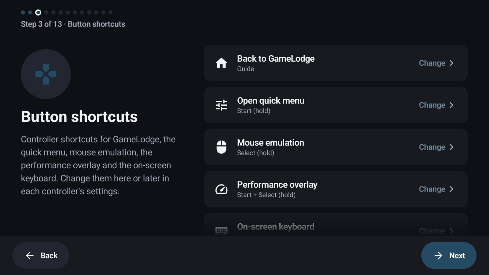

Back to GameLodge, quick menu, mouse emulation, performance overlay and on-screen keyboard, each with
**Change**. Below: enable the accessibility service so the shortcuts work in other apps too (see
[Controllers & shortcuts](controllers.md)).

## 4 · Appearance

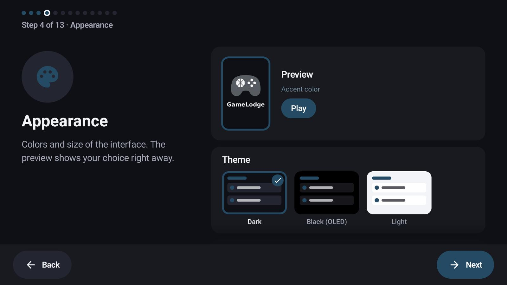

Theme, accent colour, size and animations, with a live preview.

## 5 · Home app

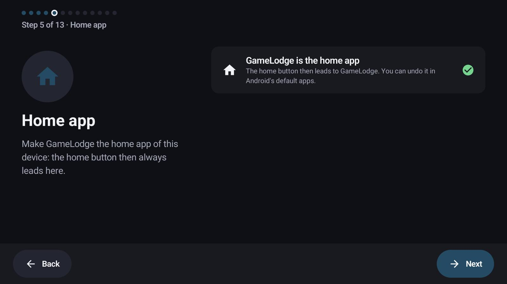

Make GameLodge the home app: the Home button then always leads to it. You can switch back any time.

## 6 · Permissions

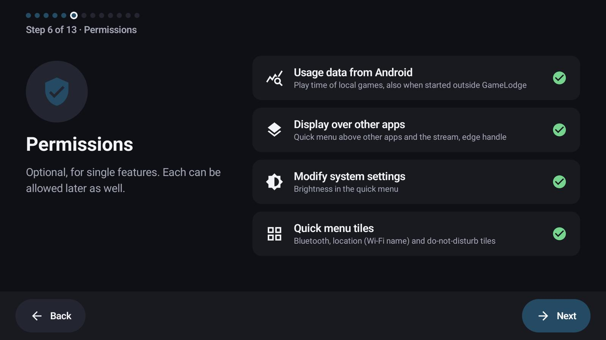

Optional, each for one feature: usage data (play time of apps started outside GameLodge), display over other
apps (the quick menu over games), modify system settings (brightness), quick menu tiles (Bluetooth, Wi-Fi
name …). See [Getting started](getting-started.md#permissions-android).

## 7 · Emulators & ROMs

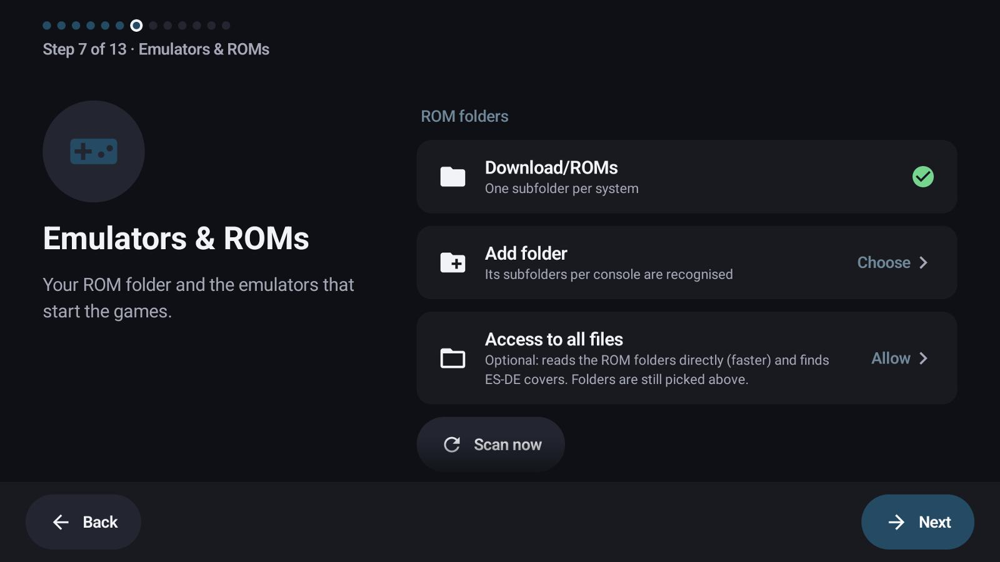

Add your ROM folders; GameLodge finds the installed emulators. See [Emulators & ROMs](emulators.md).

## 8 · Streaming hosts

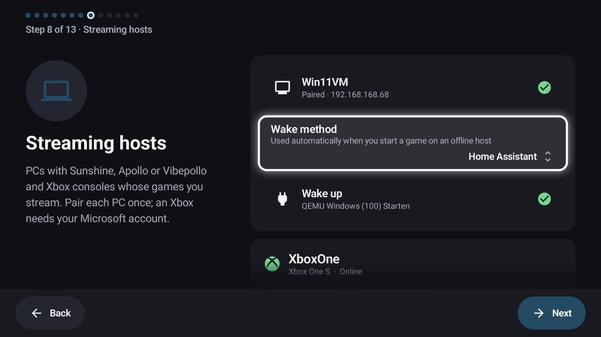

Found hosts with **Pair**, or **Add host** by address. Per host: the wake method. See
[Hosts & pairing](hosts.md).

## 9 · GameLodge on the PC

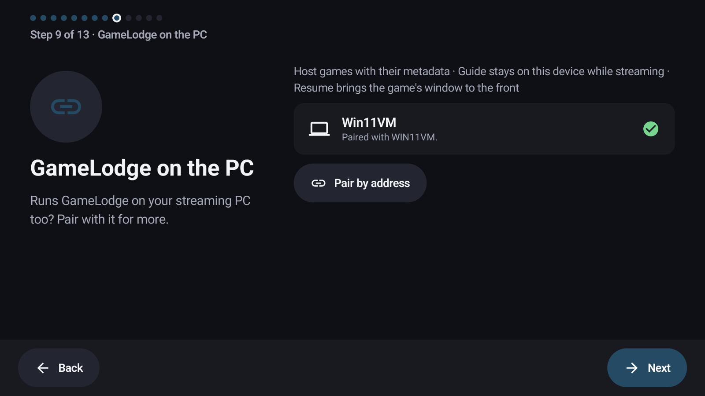

If your streaming PC runs GameLodge for Windows too, pair with it: host games with their metadata, Guide
stays on the device while streaming, resume brings the game's window to the front.

## 10 · Covers & game info

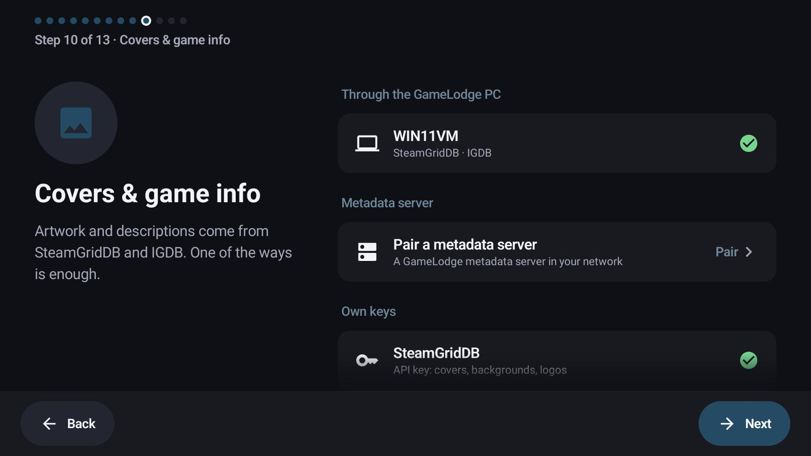

Where artwork and descriptions come from: through the GameLodge PC, a metadata server, or your own
SteamGridDB / IGDB keys – one of them is enough. Each key has a guide with a QR code.

## 11 · Home Assistant

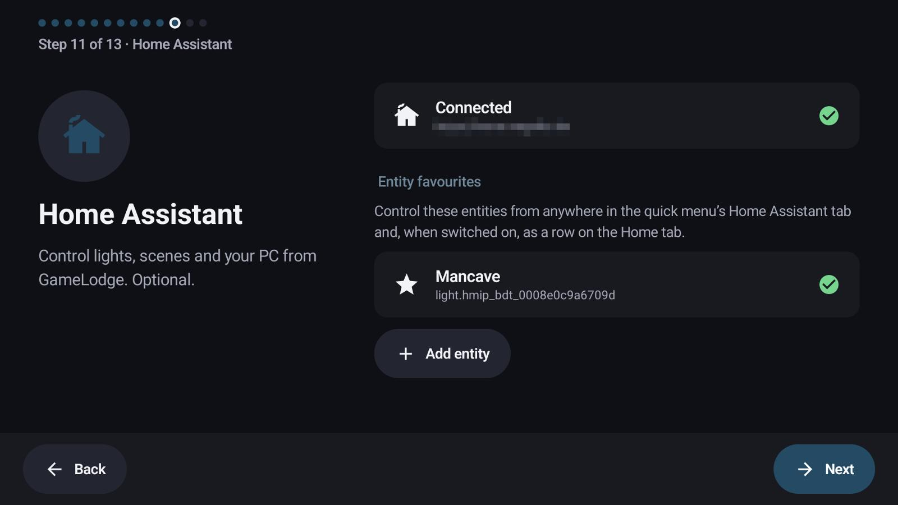

Sign in and pick the first entity tiles. See [Home Assistant](home-assistant.md).

## 12 · VPN

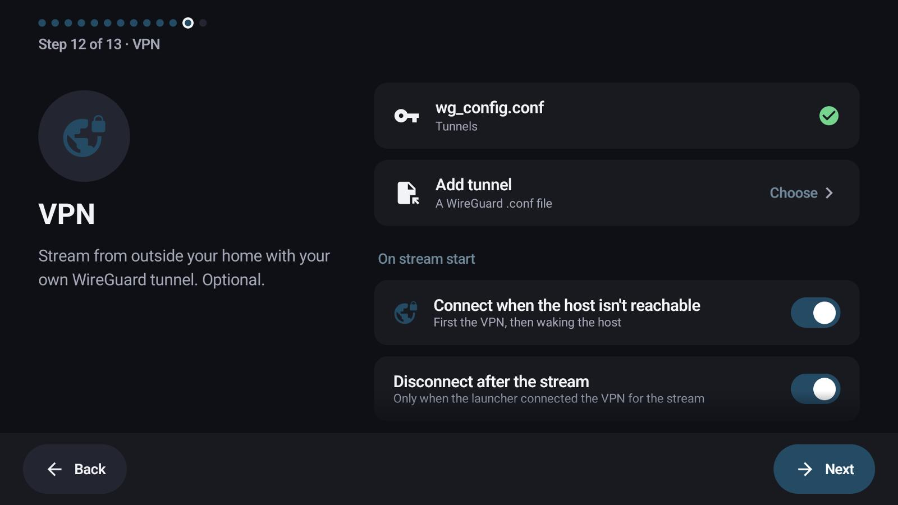

Optional: a WireGuard tunnel for streaming away from home. See [VPN](vpn.md).

## 13 · All set

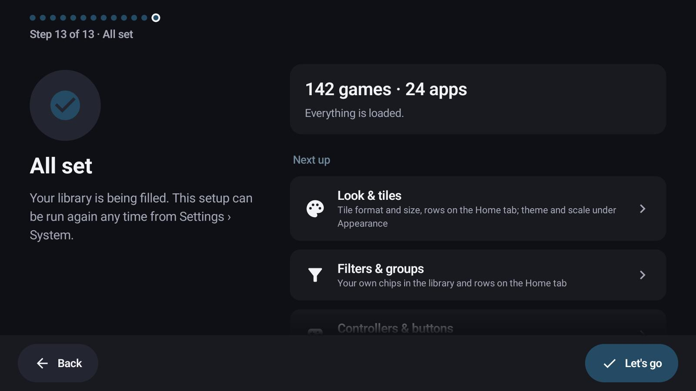

Your library is being filled. *Next up* links to the settings worth a look next: tiles, filters and groups,
controllers and buttons.

## See also

- [Getting started](getting-started.md) – install, home app, permissions
- [Hosts & pairing](hosts.md)
- [Metadata & artwork](metadata.md) – SteamGridDB and IGDB keys
- [Backup & restore](backup.md) – restoring on a new device
