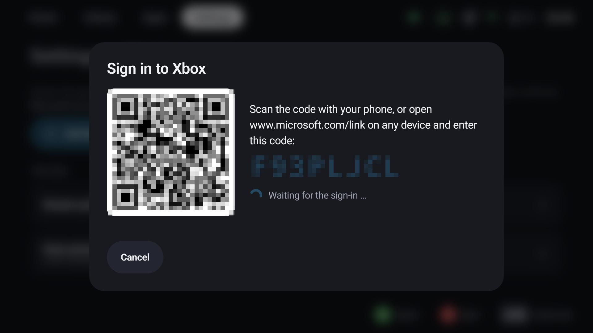
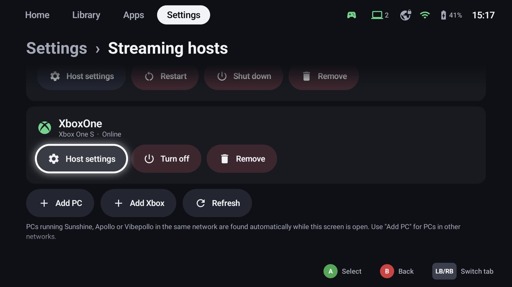

# Xbox consoles

GameLodge streams the games installed on your Xbox One or Xbox Series X|S – at home and away. The console is a
host like a PC: its games are tiles in your library, **Play** wakes the console, starts the game on it and opens
the stream. The player is built in on Android and Windows; no other app and no second sign-in.

!!! note "Unofficial"
    Xbox home streaming uses the interfaces of Microsoft's own Xbox apps, which aren't public. Microsoft can
    change them at any time. GameLodge is not affiliated with Microsoft.

## Prepare the console

On the console, under **Settings → Devices & connections → Remote features**:

- **Enable remote features** – on
- **Streaming** (*Allow streaming to other devices* or *Allow streaming from any device*) – on
- **Power mode** – *Sleep* (Standby), so GameLodge can wake the console. In *Energy saving* mode the console is
  fully off: only a [Home Assistant action](#wake-up-and-sleep) can turn it on then.

Under **Settings → Account → Sign-in, security & passkey**, set your profile to sign in automatically: a game
started remotely otherwise waits at the profile selection.

## Add the console

**Settings → Hosts → Xbox consoles → Add Xbox console** (also in the [setup wizard](wizard.md#8-streaming-hosts)):

1. Scan the QR code with your phone, or open **microsoft.com/link** on any device and enter the code shown.
2. Sign in with the Microsoft account of the console.
3. Choose the console.

GameLodge reads the console's installed games with their store artwork and adds them to the library. A game you
also have on a PC host becomes one tile with both ways to play: **Start with…** offers the PC and the Xbox.

The sign-in is not part of a [backup](backup.md) – like pairings, it stays on the device. After a restore, sign
in again; the console and its games are found again.

### Games without a license

Installed games you can only play through Game Pass or EA Play have no license of their own. **Games without a
license** chooses whether they are **hidden** (default) or shown **dimmed**.

## Playing

| | |
|---|---|
| **Play** | Wakes the console if needed, starts the game on it (unless it already runs) and opens the stream |
| **Guide** | Back to GameLodge, as in PC streams |
| **View + Menu** together | The Xbox button on the console (Xbox guide) |
| **Hold Start** | [Quick menu](quick-menu.md) over the stream |

The game running on the console is shown as running – also when another device started it. The quick menu's
*Running* tab resumes it (streams it again) or **quits** it: the stream ends and the game is closed on the
console. Play time counts while you stream.

Controllers come from GameLodge, as many as four, with rumble. Touch controls for phones without a controller
are not there yet.

## Stream settings

In the [stream profiles](profiles.md), tab **Xbox** – like the PC settings, the active profile counts, and
**Start with…** picks another one for a single launch:

| Setting | |
|---|---|
| **Resolution** | *Automatic* (1080p), 720p, 1080p or *1080p HQ* (higher bitrate, needs a strong network). The console sends at most what it manages – Xbox One consoles often stay at 720p. |
| **Bitrate limit** | The console picks the bitrate itself; this caps it, e.g. on mobile data |
| **Sharpen picture** | Upscales and sharpens the stream (FSR) – the most visible help for 720p on a large screen |
| **Picture** | Fit, stretch or zoom to the screen |
| **Vibration** | The game's rumble on your controller |

## Wake up and sleep

On the console's **Host settings**:

- **Wake-up** – in standby GameLodge wakes the console through Xbox Live. In *Energy saving* mode only a Home
  Assistant action can turn it on (e.g. HDMI-CEC of the TV or an IR blaster); set it under **Host actions →
  Wake**.
- **After the stream** – **Auto sleep** turns the console off (standby) the chosen time after the last stream. A
  Home Assistant action for sleep or shutdown is used instead when set.
- **Turn off** on the console's card does it at once.

## Away from home

The stream is set up through Microsoft's servers and then runs directly between GameLodge and the console – no
VPN needed. If your router blocks it, forward the console's UDP ports **3074** and **9002** to it.

## Windows

The Windows app plays the stream in a window of its own (the Edge engine *WebView2* that Windows 10 and 11 bring).
The launcher keeps reading the controllers while the stream is in front, so Guide and the quick menu work as
usual.

## See also

- [Hosts & pairing](hosts.md) – PC hosts
- [Home Assistant](home-assistant.md) – actions to wake the console
- [Quick menu](quick-menu.md)
- [FAQ & troubleshooting](faq.md)
